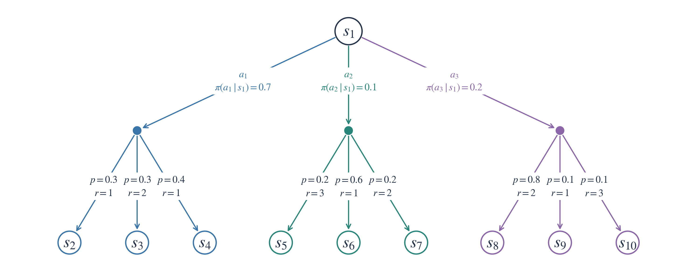
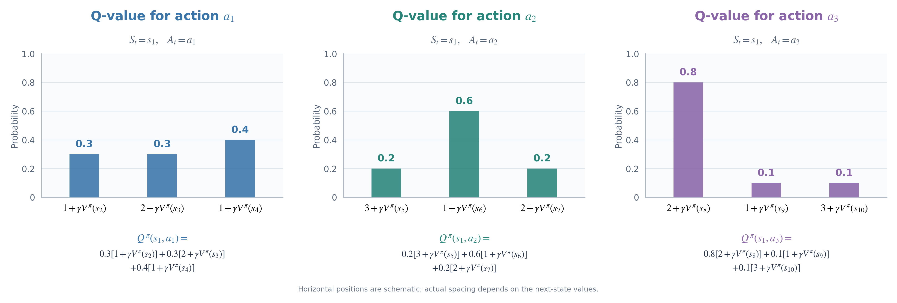
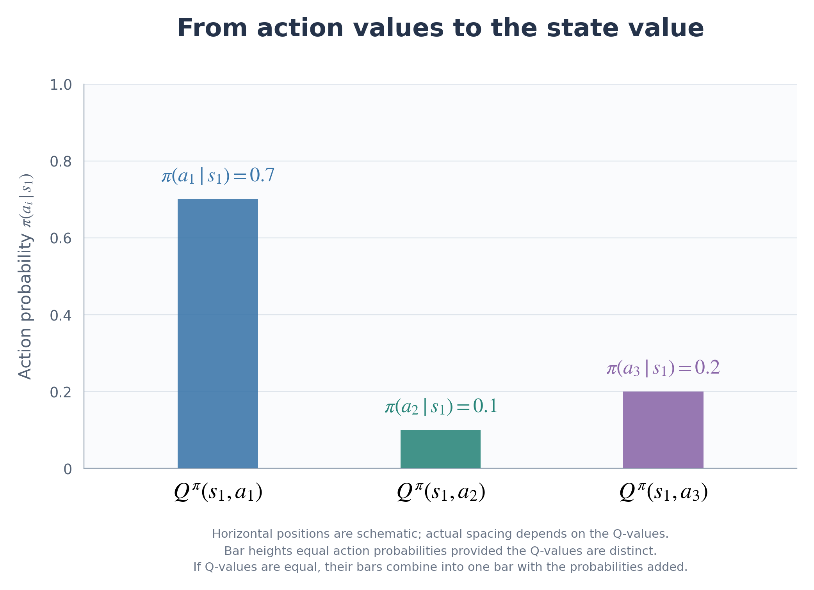
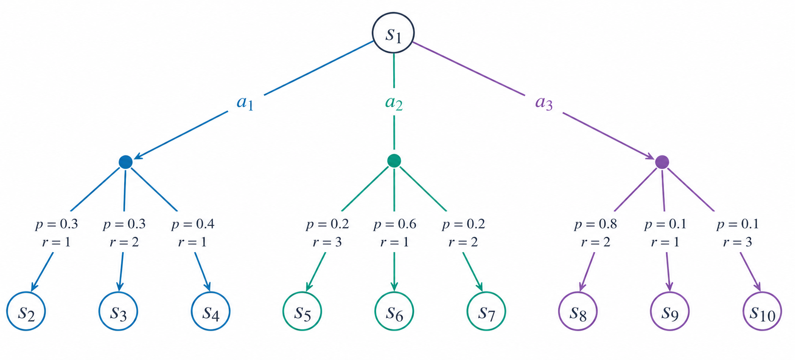
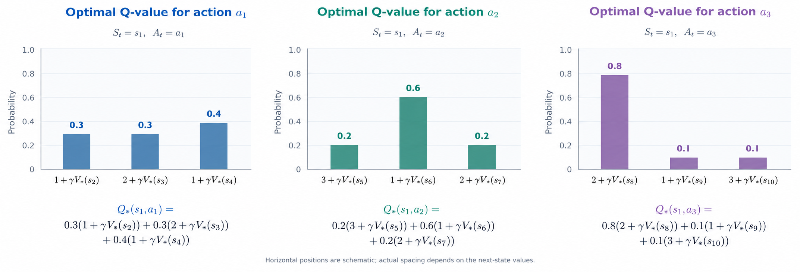
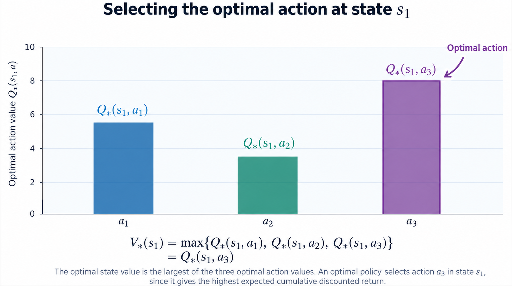

[[_TOC_]]

### Expressing action values using the next state

$q_{\pi} (s,a)$ is the probability-weighted average of all possible returns $G_{t}$ when starting in state $s$, taking action $a$, and following policy $\pi$ afterwards:

$$
q_{\pi} (s, a) = E_{\pi} [G_{t} | S_{t} = s, A_{t} = a]
$$

Each return consists of the immediate reward plus the discounted remaining return:

$$
G_{t} = R_{t+1} + \gamma G_{t+1}
$$

Substituting this gives:

$$
q_{\pi} (s, a) = E_{\pi} [R_{t+1} + \gamma G_{t+1} | S_{t} = s, A_{t} = a]
$$

We can now group the possible returns according to the next state $s'$ reached and the immediate reward $r$ received. Within each group, the immediate reward is fixed. Under the Markov property, the probability-weighted average of the remaining returns $G_{t+1}$ is $v_{\pi} (s')$, since we follow policy $\pi$ from that next state onwards.

The mean return within each group is therefore:

$$
r + \gamma v_{\pi}(s')
$$

Using the law of total expectation, we average these group means according to the probabilities of reaching their next states and receiving their rewards:

$$
q_{\pi} (s, a) = \sum_{s', r} p(s', r | s, a) [r + \gamma v_{\pi}(s')]
$$

Equivalently, we can keep this in expectation notation:

$$
q_{\pi} (s,a) = E_{\pi} [R_{t+1} + \gamma v_{\pi}(S_{t+1}) | S_{t} = s, A_{t} = a]
$$

Both expressions give the same probability-weighted average as the original definition using $G_{t}$. We have grouped the possible returns and averaged within each group, allowing us to express the action value using the immediate reward and the values of the possible next states.

### The Bellman expectation equation for state values

We have seen that $v_{\pi}(s)$ is the probability-weighted average of the Q-values for the available actions in state $s$:

$$
v_{\pi}(s) = \sum_{a}\pi(a\mid s)q_{\pi}(s,a).
$$

We can now substitute our expression for each Q-value:

$$
v_{\pi}(s) =
\sum_{a}\pi(a | s)
\sum_{s',r}p(s',r | s,a)
[r+\gamma v_{\pi}(s')].
$$

This is the Bellman expectation equation for state values. It calculates the average in two stages:

1. For each possible first action $a$, average $r+\gamma v_{\pi}(s')$ over the possible next states and rewards, weighted by $p(s',r\mid s,a)$. This gives $q_{\pi}(s,a)$.
2. Average these Q-values, weighting each one by the probability $\pi(a | s)$ of choosing that first action. This gives $v_{\pi}(s)$.

Equivalently, we can write:

$$
v_{\pi}(s)= E_{\pi}[R_{t+1}+\gamma v_{\pi}(S_{t+1}) | S_{t}=s].
$$

The expectation includes all possible first actions under policy $\pi$ and their possible next states and rewards. It gives the same probability-weighted average of returns $G_{t}$ as our original definition of $v_{\pi}(s)$, now expressed using immediate rewards and next-state values.

### Worked example

  

Suppose we are in state $s_{1}$, where three actions are available: $a_{1}$, $a_{2}$, and $a_{3}$. Our policy selects these actions with 
probabilities $0.7$, $0.1$, and $0.2$, respectively. If we take action $a_{1}$, we reach $s_{2}$ with probability $0.3$,
$s_{3}$ with probability $0.3$, or $s_{4}$ with probability $0.4$. In this example, the reward is fixed for each transition: 
these three outcomes give immediate rewards of $1$, $2$, and $1$, respectively. The possible next states, transition probabilities,
and rewards for the other two actions are shown in the diagram. We will first calculate the probability-weighted average of the immediate
reward plus the discounted next-state value for each action, giving its Q-value. We will then average these Q-values using the policy 
probabilities to obtain $v_{\pi}(s_{1})$.

  

For each action, we can visualise a probability distribution over the immediate reward plus the discounted value of the next state, $R_{t+1}+\gamma v_{\pi}(S_{t+1})$.
The Q-value is the mean of this distribution: we multiply each possible value $r+\gamma v_{\pi}(s')$ by the joint probability $p(s', r | s,a)$ of receiving that reward and
reaching that next state, then sum the results. In this example, the reward is fixed for each transition, so each bar's height is simply the probability of reaching its next 
state, given the current state and chosen action. The three graphs show these distributions for actions $a_{1}$, $a_{2}$, and $a_{3}$, with their probability-weighted 
means giving the corresponding Q-values.

  

Using the law of total expectation, we can obtain $v_{\pi}(s_{1})$ by taking a probability-weighted average of the three Q-values. Each Q-value is the mean of the possible 
returns grouped by a particular first action, and the probability of selecting that group is the policy probability $\pi(a_{i}\mid s_{1})$. We therefore multiply each Q-value 
by its action probability and sum the results: $v_{\pi}(s_{1}) = 0.7q_{\pi}(s_{1},a_{1}) + 0.1q_{\pi}(s_{1},a_{2}) + 0.2q_{\pi}(s_{1},a_{3})$. This weighted mean of the 
group means equals the probability-weighted average of all possible returns from $s_{1}$ under policy $\pi$.

### Optimal policies and optimal value functions

The goal of reinforcement learning essentially means finding a policy that gives the highest expected return. We can define an optimal policy for finite MDPs. A policy $\pi$ is better than or equal to another policy $\pi'$ if its expected return is greater than or equal to that of $\pi'$ in all states. In mathematical notation:

$$
\pi \geq \pi' \iff v_{\pi}(s) \geq V_{\pi'}(s), \quad \forall s \in S
$$

There is always a policy that is at least as good as all other policies; this is an optimal policy. We denote an optimal policy as $\pi_*$. Optimal policies do not have to be unique. The corresponding optimal state-value function, denoted $v_*$, is defined as:

$$
v_*(s) = \max_{\pi} v_{\pi}(s)
$$

Just as we define an optimal state-value function, we can also define an optimal action-value function:

$$
q_*(s,a) = \max_{\pi} q_{\pi}(s,a)
$$

Recall that $q_{\pi}(s,a)$ is the expected return from starting in state $s$, taking action $a$, and following policy $\pi$ thereafter. Therefore, $q_{*}(s,a)$ is the maximum expected return achievable when we take action $a$ in state $s$, then follow an optimal policy afterwards.

Importantly, the initial action $a$ does not have to be optimal. We are only assuming that we act optimally after taking it. When we say that we act optimally, we mean that at every subsequent state, we select an action that maximises the expected cumulative discounted return, rather than simply choosing the action with the highest immediate reward.

#### Connecting optimal state values to optimal action values

We know that $q_*(s,a)$ is the maximum expected return achievable when we take action $a$ in state $s$, then act optimally thereafter.

Since $v_*(s)$ does not restrict our initial action, we can just select whichever action has the highest optimal Q-value:

$$
v_*(s) = \max_a q_*(s,a)
$$

An optimal policy therefore selects an action that maximises the expected return:

$$
\pi_*(s) \in \arg\max_a q_*(s,a)
$$

Here, $\max$ gives the highest expected return, whereas $\arg\max$ gives the action that achieves it.

#### Bellman optimality equation for action values

Recall that the return can be expressed recursively:

$$
G_t = R_{t+1} + \gamma G_{t+1}
$$

Since $q_*(s,a)$ assumes optimal behaviour after taking action $a$, we can express it using the optimal value of the next state:

$$
q_*(s,a) = E[R_{t+1} + \gamma v_*(S_{t+1}) \mid S_t=s, A_t=a]
$$

However, we know that:

$$
v_*(s') = \max_{a'} q_*(s',a')
$$

Substituting gives the equivalent expression:

$$
q_*(s,a) = E[R_{t+1} + \gamma \max_{a'}q_*(S_{t+1},a') \mid S_t=s, A_t=a]
$$

Expanding the expectation:

$$
q_*(s,a) = \sum_{s',r}p(s',r\mid s,a)[r+\gamma\max_{a'}q_*(s',a')]
$$

These are the Bellman optimality equations for action values. We still average over the possible outcomes of an action, but assume optimal action selection from each subsequent state.

#### Worked example

  

Consider starting in state $s_1$, where three actions are available: $a_1$, $a_2$, and $a_3$.

For each action, we calculate the probability-weighted average of the immediate reward plus the discounted optimal value of the next state.

For example, taking action $a_1$:

$$
q_*(s_1,a_1) =
0.3(1+\gamma v_*(s_2))
+0.3(2+\gamma v_*(s_3))
+0.4(1+\gamma v_*(s_4))
$$

We can visualise this calculation for all three actions:

  

Each graph represents a probability distribution over $R_{t+1}+\gamma v_*(S_{t+1})$. Its probability-weighted mean gives the corresponding optimal Q-value.

The environment's transition probabilities remain unchanged. The difference from $q_{\pi}$ is that we now use $v_*$ instead of $v_{\pi}$, assuming optimal behaviour after reaching the next state.

#### Selecting the optimal action

Under a particular policy $\pi$, we calculate the state value by taking a weighted average of the Q-values:

$$
v_{\pi}(s)=\sum_a\pi(a\mid s)q_{\pi}(s,a)
$$

However, for the optimal state value, we instead select the action with the highest optimal Q-value, as illustrated below:

  

The numerical Q-values are illustrative rather than calculated from the preceding transition tree.

Unlike the Bellman expectation equation, we no longer average over actions according to a fixed policy. Instead, we maximise over the available actions, while still averaging over the environment's possible outcomes.

The graph illustrates how an optimal policy selects the action with the highest expected cumulative discounted return. The numerical Q-values are illustrative, rather than calculated from the preceding transition tree.

Unlike the Bellman expectation equation, we no longer average over actions according to a fixed policy. Instead, we maximise over the available actions, while still averaging over the environment's possible outcomes.

#### Bellman optimality equation for state values

Recall that:

$$
v_*(s)=\max_a q_*(s,a)
$$

Substituting our expression for $q_*(s,a)$ gives:

$$
v_*(s)=\max_a E[R_{t+1}+\gamma v_*(S_{t+1})\mid S_t=s,A_t=a]
$$

Equivalently:

$$
v_*(s)=\max_a\sum_{s',r}p(s',r\mid s,a)[r+\gamma v_*(s')]
$$

This is the Bellman optimality equation for state values.

The maximum is outside the expectation because we choose our action before observing the next state. We maximise over actions, not over the random outcomes produced by the environment.

