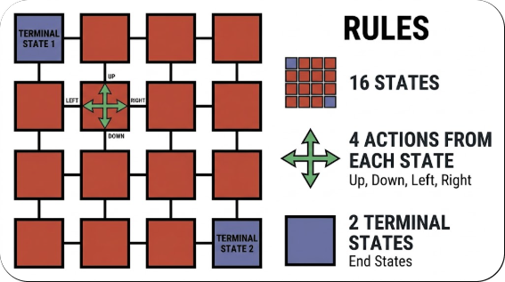

[[_TOC_]]

### Policy Evaluation

Policy Evaluation refer to computing the state-value function, $v_{\pi}(s)$, or the action-value function, $q_{\pi}(s, a)$ for a given policy $\pi$ for all states or state action pairs for some MDP.

  

Say we have 16 states, of which 2 are terminal states. We have 4 actions available in each state, up, right, down, left which will move the agent to its corresponding neighbouring state, unless that state is off the grid, in that case it will remain in the same state.

Every action the agent makes will give a reward of -1 with no discounting ($\gamma = 1$), so the goal is to get to a terminal state as soon as possible.

Lets say we intialise the value of each state with a random value, with the exception that the terminal states have a value of 0, which is always true. Then, we can reassign the value of each state in our grid using the state-value Bellman Equation

$$
V(s) \leftarrow \sum _{a \in A(s)} \pi (a | s) \sum_{s' \in S, r \in R}p(s', r | s, a)[r + \gamma V(s')]
$$

When we perform this for each value in the grid, this is called a sweep. After each sweep, we check the largest absolute change in any state's estimated value:

$$
\Delta = \max_{s \in S} |V_{\text{new}}(s) - V_{\text{old}}(s)|
$$

If $\Delta$ is smaller than some threshold $\theta$,then we stop.

This is what policy evaluation is, we change the bellman equation into an assignment, repeatably apply it starting from random values until the value of each state stops changing by some small amount.

For action-values, the process is the same, except we initialise the state-action value with random values, and update them using the bellman equation for action-values instead. i.e., 

$$
Q(s, a) \leftarrow \sum_{s' \in S, r \in R} p(s', r | s, a) [r + \gamma \sum_{a' \in A(s')} \pi (a' | s') Q(s', a')]
$$

### Policy Improvement

The question policy improvement aims to answer is: given the true value of every state under some policy $\pi$, $v_\pi(s)$, can we determine a better policy $\pi'$?

For simplicity, assume our policy is deterministic, meaning that in any state $s$, the policy always selects a particular action with probability 1, $a = \pi(s)$. Other actions may be available, but the policy always selects the same one.

We know that an optimal policy chooses an action that gives the largest optimal action-value in any state $s$:

$$
\pi_*(s) = \operatorname*{argmax}_a q_*(s, a)
$$

Similarly, we can define a new policy that selects the action with the largest action-value under our current policy $\pi$:

$$
\pi'(s) = \operatorname*{argmax}_a q_{\pi}(s, a)
$$

Recall that $q_\pi(s,a)$ represents the expected return from taking action $a$ in state $s$, then following policy $\pi$ thereafter. If we already know the state-values $v_\pi(s)$, we can calculate these action-values using:

$$
q_\pi(s,a) = \sum_{s',r}p(s',r\mid s,a)[r+\gamma v_\pi(s')]
$$

Essentially, we calculate the action-values for every available action in each state under our original policy $\pi$. We then define a new policy $\pi'$ that selects the action with the largest action-value in each state.

We say this new policy is acting greedily with respect to $q_\pi$, since it selects the action with the highest expected return in each state. Importantly, these action-values account for future rewards, not just the immediate reward.

Due to the policy improvement theorem, this new policy is guaranteed to be at least as good as our original policy in every state, assuming exact action-values. I won't go into the proof of this theorem here.

$$
v_\pi(s) \leq v_{\pi'}(s), \quad \forall s \in S
$$

If our original policy $\pi$ is already choosing an action that gives the largest action-value in every state, such that:

$$
\pi(s) \in \operatorname*{argmax}_a q_\pi(s,a), \quad \forall s \in S
$$

then our policy is already optimal (under the standard assumptions for a finite discounted MDP). This is because no greedy improvement can produce a better policy, so the Bellman optimality condition is satisfied.

Therefore:

$$
v_\pi(s) = v_*(s), \quad \forall s \in S
$$

In other words, $\pi$ is an optimal policy. There may be multiple optimal policies, so they do not necessarily select identical actions in every state.

### Generalised Policy Iteration (GPI)

Generalised Policy Iteration (GPI) refers to the general process of alternating between policy evaluation and policy improvement. Two algorithms that follow this principle are policy iteration and value iteration.

#### Policy Iteration

We start with some arbitrarily initialised policy $\pi_0$. This could be a deterministic policy or a stochastic policy that assigns probabilities to the available actions in each state.

To find the value function of each state under this policy, we perform policy evaluation, repeatedly applying the Bellman expectation update until the values converge sufficiently.

Using these state-values, we can then perform policy improvement to create a new policy $\pi_1$ that is at least as good as $\pi_0$.

Now, because we have changed our policy, the previous value function no longer necessarily represents the true values under our new policy. We therefore perform policy evaluation again to obtain $v_{\pi_1}(s)$, which we can then use to improve the policy again, obtaining $\pi_2$.

We continue alternating between policy evaluation and policy improvement until the policy no longer changes. At this point, under the standard assumptions for a finite discounted MDP with exact evaluation, we have reached an optimal policy and its corresponding optimal value function.

$$
\pi_0 \xrightarrow{E} v_{\pi_0} \xrightarrow{I} \pi_1 \xrightarrow{E} v_{\pi_1} \xrightarrow{I} \pi_2 \xrightarrow{E} \dots \xrightarrow{I} \pi_* \xrightarrow{E} v_*
$$

Here, $E$ represents policy evaluation and $I$ represents policy improvement. In practical implementations, evaluation is often stopped once the value estimates change by less than some small threshold, rather than waiting for exact convergence.

#### Value Iteration

In policy iteration, we perform multiple sweeps using the Bellman expectation equation until the state-values converge sufficiently. We then improve the policy by choosing the action with the largest action-value $q_\pi(s,a)$ in each state, and repeat.

Value iteration takes a slightly different approach. Instead of fully evaluating a policy before improving it, we combine evaluation and improvement into a single update.

We start by initialising the state-value estimates $V(s)$ arbitrarily, usually to zero. Then, for one state at a time, we do the normal value update:

$$
V(s) \leftarrow \sum _{a \in A(s)} \pi (a | s) \sum_{s' \in S, r \in R}p(s', r | s, a)[r + \gamma V(s')]
$$

and update the state's value to the maximum expected return by choosing the action that gives the largest q value for that state.

This is equivalent to applying the Bellman optimality update:

$$
V(s) \leftarrow \max_{a \in A(s)} \sum_{s',r}p(s',r\mid s,a)[r+\gamma V(s')]
$$

to each state one at a time.

The maximisation effectively incorporates greedy policy improvement into each update, while the Bellman update improves our value estimates.

Once we have applied this update to every state, we have completed one sweep, which can be viewed as one iteration combining policy evaluation and improvement.

We repeat these sweeps until the maximum change in state-values falls below some threshold $\theta$:

$$
\Delta = \max_{s\in S}|V_{\text{new}}(s)-V_{\text{old}}(s)| < \theta
$$

Once our estimates have converged sufficiently towards the optimal value function $v_*(s)$, we can extract a greedy policy:

$$
\pi(s) = \underset{a \in A(s)}{\operatorname{argmax}} \sum_{s',r}p(s',r\mid s,a)[r+\gamma V(s')]
$$

The distinction is:

- Policy iteration: Perform multiple policy evaluation sweeps until convergence, improve the policy, and repeat.
- Value iteration: Perform one sweep of Bellman optimality updates, combining evaluation and greedy improvement, then repeat until the values converge.

Unlike policy iteration, value iteration does not need to explicitly maintain a policy during the updates, since the maximisation is already incorporated into the Bellman optimality equation.

However, these dynamic programming algorithms have limitations. They require a known model of the environment, including the transition probabilities and rewards. Furthermore, as the state space grows, repeatedly updating every state's value becomes computationally expensive.

This motivates model-free reinforcement learning methods, such as Monte Carlo methods, which estimate value functions from sampled experience rather than requiring knowledge of the environment's transition probabilities.

I'll explore Monte Carlo methods next.