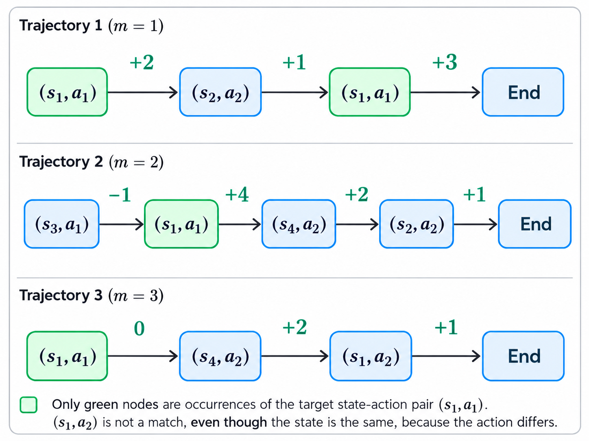

[[_TOC_]]

### Monte Carlo Methods:

Monte Carlo methods can be used when we do not know the environement dynamics, specifically $p(s', r | s, a)$. We can think of this term as the transition probabilities between each state, along with what reward we will get for that transition.

Instead, we run some policy $\pi$ through the MDP and get samples of trajectories:

$$
S_{0}, A_{0}, R_{1}, S_{1}, A_{1}, R_{2}, S_{2}, A_{2} \cdots , R_{T}, S_{T}
$$

Monte Carlo using averages over trajectories to approximate expected values and GPI to obtain politices to approximate the optimal policy. MC does not approximate $p(s', r | s, a)$.

#### Model-Free vs Model-Based methods

We can think of a model as anything the agent uses to predict how the environement will respond to its action. An example of a model would be $p(s', r | s, a)$, since we can use it to get an idea of the state we will land in and the reward we will get for some action.

- **Model-Based methods:** These are methods that use a model to plan the actions it takes.

- **Model-Free methods:** These are methods that do not use a model. They instead learn associations between actions and returns

Monte Carlo methods are model free, they do not use a model to predict how the environement will respond to actions. Because of this, we need to estimate action values instead of state values. To see this, lets say we estimated $v_{*}(s)$ with $V(s)$. To find the max-value action, we still have to form an estimate of $q_{*}(s,a)$:

$$
Q(s,a) = \sum_{s' \in S, r \in R} p(s', r | s, a) [r + \gamma V(s')]
$$

But because Monte Carlo is model-free, we do not have $p(s', r | s, a)$, meaning we would have to estimate $q_{*}(s, a)$ anyway, so we may as well do that directly.

#### Monte Carlo Evaluation

The goal of Monte Carlo evaluation is: given sample trajectories generated under a policy $\pi$, estimate $q_{\pi}$, i.e. estimate the action value for state-action pairs.

When doing Monte Carlo evaluation, we can express estimation of $q_{\pi}$ as estimation of a state-value function in a new process.

To see this, start from the usual state-value definition:

$$
v_{\pi}(s) = E_{\pi}[G_{t} | S_{t} = s]
$$

Now define the state of a new problem to be a state-action pair:

$$
S^{new}_{t} = (S_{t}, A_{t})
$$

Then the value of one of these new states is:

$$
v^{new}_{\pi}((s,a)) = E_{\pi}[G_{t} | S^{new}_{t} = (s,a)]
$$

But saying $S^{new}_{t} = (s,a)$ means exactly that, in the original problem, we are in state $s$ and take action $a$. So this becomes:

$$
v^{new}_{\pi}((s,a)) = E_{\pi}[G_{t} | S_{t} = s, A_{t} = a]
$$

And this is precisely the definition of the action-value function:

$$
q_{\pi}(s,a) = E_{\pi}[G_{t} | S_{t} = s, A_{t} = a]
$$

So we get:

$$
v^{new}_{\pi}((s,a)) = q_{\pi}(s,a)
$$

Therefore, estimating $v^{new}_{\pi}((s,a))$ in this new problem is the same as estimating $q_{\pi}(s,a)$ in the original problem.

Since we have fixed the policy $\pi$, and actions are now encoded in the state, this new process is a Markov Reward Process (MRP), i.e. a process with no explicit action choices. Its trajectories look like:

$$
S_{0}, R_{1}, S_{1}, R_{2}, S_{2}, \cdots, R_{T}, S_{T}
$$

So our data consists of $M$ trajectory samples from an MRP. We can write one trajectory sample as:

$$
s^{m}_{0}, r^{m}_{1}, s^{m}_{1}, \cdots, s^{m}_{T_{m}}, \quad m = 1, \ldots, M
$$

Where $M$ is the number of trajectories. The superscript $m$ tells us which trajectory we are in, and the subscript tells us the position within that trajectory.

The idea of Monte Carlo is to use averages to approximate the value function. For ordinary state values this gives:

$$
E_{\pi}[G_{t} | S_{t} = s] \approx \frac{1}{C(s)} \sum^{M}_{m=1} \sum^{T_{m}-1}_{\tau=0} \mathbb{I}[s^{m}_{\tau}=s]g^{m}_{\tau}
$$

Since we have defined states to be state-action pairs, we get the Monte Carlo estimate for the action-value function:

$$
q_{\pi}(s,a) \approx Q_{\pi}(s,a) = \frac{1}{C(s,a)} \sum^{M}_{m=1} \sum^{T_{m}-1}_{\tau=0} \mathbb{I}[(s^{m}_{\tau},a^{m}_{\tau})=(s,a)]g^{m}_{\tau}
$$

Here, $C(s,a)$ is the total number of times the state-action pair $(s,a)$ appears across all trajectories, and $g^{m}_{\tau}$ is the return observed from time step $\tau$ onward in trajectory $m$.

**Example:**

  

Let us estimate the value of the state-action pair $(s_{1},a_{1})$.

$$
q_{\pi}(s_{1},a_{1}) \approx Q_{\pi}(s_{1},a_{1}) = \frac{1}{C(s_{1},a_{1})} \sum^{M}_{m=1} \sum^{T_{m}-1}_{\tau=0} \mathbb{I}[(s^{m}_{\tau},a^{m}_{\tau})=(s_{1},a_{1})]g^{m}_{\tau}
$$

This equation tells us to go through each trajectory one by one, and every time we encounter the state-action pair $(s_{1},a_{1})$, we add the return from that time step.

For this example, we assume $\gamma = 1$, so the return is just the sum of all future rewards.

For the first trajectory, we see $(s_{1},a_{1})$ twice: once at time step $\tau=0$, and once at time step $\tau=2$. So the total contribution from trajectory 1 is:

$$
g^{1}_{0} + g^{1}_{2} = (2 + 1 + 3) + (3) = 9
$$

For the second trajectory, we see $(s_{1},a_{1})$ once, at time step $\tau=1$. The return from that point is:

$$
g^{2}_{1} = 4 + 2 + 1 = 7
$$

For the third trajectory, we see $(s_{1},a_{1})$ once, at time step $\tau=0$. The return from that point is:

$$
g^{3}_{0} = 0 + 2 + 1 = 3
$$

So the total contribution is:

$$
9 + 7 + 3 = 19
$$

The state-action pair $(s_{1},a_{1})$ appears a total of 4 times across all trajectories, so:

$$
C(s_{1},a_{1}) = 4
$$

Therefore, our Monte Carlo estimate is:

$$
q_{\pi}(s_{1},a_{1}) \approx Q_{\pi}(s_{1},a_{1}) = \frac{1}{4}(9 + 7 + 3) = \frac{19}{4} = 4.75
$$

So our estimate of the true action value $q_{\pi}(s_{1},a_{1})$ is:

$$
Q_{\pi}(s_{1},a_{1}) = 4.75
$$

This is an example of every-visit Monte Carlo, because we include the return from every occurrence of the state-action pair $(s_{1},a_{1})$, even if it appears multiple times in the same trajectory.

However, there is one limitation with our previous approach. To calculate the estimate using the batch formula, we would need to collect the returns from our sampled trajectories and then compute their average. Instead, we can calculate this average incrementally, updating our estimate whenever a new return becomes available.

We can do this using the formula:

$$
Q_{\pi}(s,a) \leftarrow Q_{\pi}(s,a) + \frac{1}{C(s,a)}(g_{\tau}^{m} - Q_{\pi}(s,a))
$$

This produces exactly the same result as calculating the average directly. However, instead of storing all the previous returns for a state-action pair, we only need to maintain our current estimate $Q_{\pi}(s,a)$ and the number of returns observed so far, $C(s,a)$.

To demonstrate this, let's return to our previous example. This time, rather than having all three trajectories available from the beginning, we collect them one at a time and update our estimate as each trajectory finishes.

Assume we initialise our estimate to:

$$
Q_{\pi}(s_{1},a_{1}) = 0
$$

We begin by running the first trajectory. Once it finishes, we can calculate the returns from each occurrence of $(s_{1},a_{1})$.

The first occurrence is at time step $\tau=0$, giving us $g^{1}_{0}=6$. Since this is our first observed return, $C(s_{1},a_{1})=1$, so we update our estimate:

$$
Q_{\pi}(s_{1},a_{1}) \leftarrow 0 + \frac{1}{1}(6-0) = 6
$$

We then take the second return from the same trajectory, $g^{1}_{2}=3$. We have now observed two returns, so $C(s_{1},a_{1})=2$:

$$
Q_{\pi}(s_{1},a_{1}) \leftarrow 6 + \frac{1}{2}(3-6) = 4.5
$$

Next, we run the second trajectory. Once it finishes, we obtain the return $g^{2}_{1}=7$ from its occurrence of $(s_{1},a_{1})$. This is our third observed return, so:

$$
Q_{\pi}(s_{1},a_{1}) \leftarrow 4.5 + \frac{1}{3}(7-4.5) = \frac{16}{3} \approx 5.333
$$

Finally, we run the third trajectory. This gives us the return $g^{3}_{0}=3$, which is our fourth observed return. We update our estimate one last time:

$$
Q_{\pi}(s_{1},a_{1}) \leftarrow \frac{16}{3} + \frac{1}{4}\left(3-\frac{16}{3}\right) = \frac{19}{4} = 4.75
$$

We have therefore obtained exactly the same estimate as before:

$$
Q_{\pi}(s_{1},a_{1}) = 4.75
$$

The difference is that we calculated the average incrementally, without needing to store all the previous returns or wait until all $M$ trajectories had been collected. Of course, we do this for all states.

As we collect more samples, $C(s,a)$ increases, meaning the term $\frac{1}{C(s,a)}$ becomes smaller. This means each new return has a smaller influence on our current estimate, making it progressively more stable as we observe more returns. Although returns from earlier trajectories can cause larger changes to our estimate, they do not have more weight in the final result. Since we are computing the average incrementally, every observed return contributes equally to our final estimate.

One important detail is that we still need each trajectory to finish before calculating its returns, since the return $g^{m}_{\tau}$ depends on the rewards received from time step $\tau$ until the end of that trajectory. However, once these returns become available, we can immediately use them to update our estimate.

#### Constant-α Monte Carlo

Previously, we used $\frac{1}{C(s,a)}$ as our step size when updating our estimate. However, we can instead replace this with a constant step size $\alpha$, giving us:

$$
Q_{\pi}(s,a) \leftarrow Q_{\pi}(s,a) + \alpha(g^{m}_{\tau} - Q_{\pi}(s,a))
$$

Here, $\alpha$ is our learning rate, typically between 0 and 1, which determines how much we move our current estimate towards the newly observed return. For example, if $\alpha = 0.1$, we move 10% of the distance between our current estimate and the new return.

The key difference is how we weight our observations. With our previous incremental averaging method, every observed return has equal weight in the current average. Although the step size $\frac{1}{C(s,a)}$ gets smaller as we collect more samples, the contributions of all previous returns are also reduced equally. Therefore, older returns are not given more weight than newer ones.

With constant-$\alpha$ Monte Carlo, however, newer returns receive more weight than older ones. To understand why, we can rearrange our update rule:

$$
Q_{\pi}(s,a) \leftarrow (1-\alpha)Q_{\pi}(s,a) + \alpha g^{m}_{\tau}
$$

This shows that whenever we update our estimate, we retain a fraction $(1-\alpha)$ of our previous estimate and give the new return a weight of $\alpha$.

However, our previous estimate already contains contributions from earlier returns. This means that every time we perform an update, the influence of all previous returns is multiplied by $(1-\alpha)$ again.

For example, if $\alpha = 0.5$, the newest return receives a weight of 0.5, the previous return has a weight of 0.25, the one before that has a weight of 0.125, and so on.

More generally, after observing $n$ returns $g_{1}, g_{2}, \ldots, g_{n}$, we can express our estimate as:

$$
Q_{n} = (1-\alpha)^{n}Q_{0} + \sum^{n}_{i=1}\alpha(1-\alpha)^{n-i}g_{i}
$$

Here, $Q_{0}$ is our initial estimate, and $g_{i}$ is the $i$-th observed return for our state-action pair.

Notice that the weight of each return is:

$$
\alpha(1-\alpha)^{n-i}
$$

As an observation gets older, $n-i$ becomes larger, meaning its weight decreases exponentially.

Therefore, unlike ordinary incremental averaging, constant-$\alpha$ Monte Carlo gives greater weight to more recent observations. This can be particularly useful in non-stationary environments, where the expected returns may change over time, since our estimate can adapt to newer observations instead of being heavily influenced by old ones.

One important consequence is that constant-$\alpha$ Monte Carlo no longer computes the exact arithmetic average of all observed returns. Instead, it maintains a recency-weighted estimate. In general, the value of $\alpha$ is problem dependent.

#### Monte Carlo Control

So far, we have used Monte Carlo methods for policy evaluation, where we estimate the value of each state-action pair, $q_{\pi}(s,a)$, under a given policy $\pi$.

Monte Carlo control extends this by introducing policy improvement, allowing us to learn increasingly better policies. The process involves:

Policy evaluation: Generate episodes using the current policy $\pi$ and use the observed returns to estimate the action values $Q(s,a)$.

Policy improvement: Use these estimates to improve the policy by favouring actions with higher estimated returns.

Repeat: Continue evaluating and improving the policy, ideally converging towards the optimal policy $\pi_*$.

However, this introduces an important problem. If we always select the action with the highest estimated value, we might never discover that another action is actually better.

##### Exploration vs Exploitation Trade-off

To discover an optimal policy, we must sufficiently explore the available state-action pairs. However, to achieve high returns, we must also exploit actions that we already know have high values.

The question becomes: how do we balance these two objectives such that we explore enough to discover better actions, while still making use of what we already know? This is known as the exploration–exploitation trade-off, and finding effective ways to balance the two remains an important area of research.

Let's pretend we have an infinite amount of data. In principle, we can discover the optimal policy, $\pi_*$, if we ensure that every relevant state-action pair continues to be explored sufficiently.

One way to encourage this is through a soft policy. A soft policy assigns a non-zero probability to every available action in every non-terminal state:

$$
\pi(a | s) > 0, \quad \forall s \in S,\quad \forall a \in A(s)
$$

This is important because, assuming states are reachable and visited sufficiently often, we can eventually observe returns for every available state-action pair. We can therefore estimate their $q_{\pi}(s,a)$ values and use policy improvement to favour actions with higher expected returns.

However, there is one important distinction: a permanently soft policy does not necessarily converge to the optimal deterministic policy, because it must continue assigning some probability to suboptimal actions.

Ideally, we want to maintain exploration while learning, but gradually favour the best actions as our estimates become more accurate. This motivates methods such as $\epsilon$-greedy policies, where we balance exploration and exploitation by controlling how frequently we select a random action.

##### ε-greedy Monte Carlo Control

In Monte Carlo control, we generate an episode, update our Q-value estimates using the observed returns, then improve our policy. ε-greedy balances exploiting the best-known action with exploring alternatives.

With a single best action, the policy is:

$$
\pi(a | s) =
\begin{cases}
1 - \epsilon + \frac{\epsilon}{|A(s)|}, & \text{if } a = \arg\max_{a'} Q(s,a') \\
\frac{\epsilon}{|A(s)|}, & \text{otherwise}
\end{cases}
$$

Here, $|A(s)|$ is the number of available actions in state $s$. If $m$ actions tie for the highest Q-value, we break ties uniformly: each tied action receives $\frac{1-\epsilon}{m} + \frac{\epsilon}{|A(s)|}$, while every other action receives $\frac{\epsilon}{|A(s)|}$.

**Example:**

Start in $s_{0}$ with actions $a_{1},a_{2},a_{3}$ and $Q(s_{0},a_{i})=0$ (zero is a common initialisation, not a requirement). All actions tie, so each initially has probability $1/3$.

Suppose our first episode begins with $a_{1}$ and produces return $g_{0}=5$. The first-visit Monte Carlo update gives:

$$
Q(s_{0},a_{1}) \leftarrow 0 + \frac{1}{1}(5-0) = 5
$$

With $\epsilon=0.1$, policy improvement makes $a_{1}$ the preferred action:

$$
\pi(a_{1} | s_{0}) = 0.9 + \frac{0.1}{3} = 0.9333
$$

$$
\pi(a_{2} | s_{0}) = \pi(a_{3} | s_{0}) = \frac{0.1}{3} = 0.0333
$$

We update the policy probabilities, rather than selecting another action during improvement. Future episodes mostly exploit $a_{1}$ but sometimes explore $a_{2}$ or $a_{3}$. We repeat episode generation, Q-value updates, and policy improvement.

**Why is this useful?**

Imagine that the true optimal action values are:

$$
q_{*}(s_{0},a_{1})=5, \quad q_{*}(s_{0},a_{2})=10, \quad q_{*}(s_{0},a_{3})=2
$$

We don't know these values. Our Q-table currently favours $a_{1}$ because it's the only action we've sampled. But exploration may eventually select $a_{2}$, and sufficiently high observed returns could make its estimated Q-value exceed that of $a_{1}$. During policy improvement, $a_{2}$ would then become our preferred action.

That's why we keep exploring even after finding an apparently good action.

#### On-Policy ε-Greedy Monte Carlo Control (Constant-α)

Putting all this together, we get this algorithm:

**Algorithm inputs:**

$\epsilon > 0, \qquad \alpha \in (0,1], \qquad M \in \mathbb{N}$

**Initialise arbitrarily:**

$\quad \pi \leftarrow \text{some } \epsilon\text{-soft policy}$

$\quad Q(s,a) \leftarrow \text{some value for } s \in S,\ a \in A(s)$

**For $m = 1, \ldots, M$:**

$\quad$ Under $\pi$, sample an episode: $\quad s_{0}^{m}, a_{0}^{m}, r_{1}^{m}, \ldots, a_{T_{m}-1}^{m}, r_{T_{m}}^{m}$

$\quad$ For $t = 0, \ldots, T_{m}-1$:

$\qquad g_{t}^{m} \leftarrow r_{t+1}^{m} + \gamma r_{t+2}^{m} + \gamma^{2}r_{t+3}^{m} + \ldots$

$\qquad Q(s_{t}^{m},a_{t}^{m}) \leftarrow Q(s_{t}^{m},a_{t}^{m}) + \alpha \left(g_{t}^{m} - Q(s_{t}^{m},a_{t}^{m})\right)$

$\qquad \pi \leftarrow \epsilon\text{-greedy}(Q)$

### On-policy and Off-policy methods

So far, we have been looking at on-policy methods. Our policy has been playing two roles, and we can see it explicitly in the psuedocode for the algorithm we just described.

Here it was used to produce and episode:

$$
\text{Under } \pi, \text{ sample an episode: } \quad s_{0}^{m}, a_{0}^{m}, r_{1}^{m}, \ldots, a_{T_{m}-1}^{m}, r_{T_{m}}^{m}
$$

And here it is returned 

$$
\qquad \pi \leftarrow \epsilon\text{-greedy}(Q)
$$

for off-policy methods, these rules are seperated. We have one policy, the behaviour policy, that is used to generate the data (the trajectory), which we'll call $b(a | s)$

The target policy is the policy we would like to iteratively improve and evaluate so it can approximate the optimal policy, we will refer to this using the notation we have already been using, $\pi(a | s)$

For on-policy methods $b = \pi$, the policy that generates the data is also the one we want to iteratively improve. For off-policy methods $b \neq \pi$, the policy that generates the data is different to the one we want to iteratively improve.

If we're only familar with on-policy methods, then if we were to start at a new job where previous data has already been generated, then we would need to throw all this data away, since the data was not generated by some policy iteration strategy we were yet to create. This is, of course, not practical, since we would like to use this data. This is where off-policy methods become useful.

**Adjustments needed for off-policy:**

We want 

$$
q_{\pi}(s,a) = E_{\pi}[G_{t} | S_{t} = s, A_{t} = a]
$$

the q value of taking action a in state s under our target policy $\pi$. However, our data is under b. So, without any adjustments, if we used monte carlo control, we would be estimating 

$$
E_{b}[G_{t} | S_{t} = s, A_{t} = a]
$$

the expected return under b. To combat this, we use importance sampling, which I will dive deeper into shortly in a future file. We can use this to estimate the expectation of one distribution using samples from another. Using this, we get:

$$
q_{\pi}(s, a) = E_{b}[\frac{p_{\pi}(G_{t})}{p_{b}(G_{t})} G_{t} | S_{t} = s, A_{t} = a]
$$

So we weight each return by the ratio of the probability of that return occuring under policy b divided by the the probability of that return occuring under policy $\pi$. We will call this ratio: 

$$
\rho = \frac{p_{\pi}(G_{t})}{p_{b}(G_{t})} = \prod^{T - 1}_{\tau = t + 1}\frac{\pi(A_{t} | S_{t})}{b(A_{t} | S_{t})}
$$

Next, we also need coverage. Coverage means if the target policy $\pi$ might take a specific action in a given state, $\pi (s | a) > 0$, then so must the behaviour policy $b (s | a) > 0$ this ensures that we wont have zero data in places where the target policy could end up.

**Example: When coverage is violated**

Suppose we have the following target and behaviour policies in state $s_{0}$:

| Action | Target policy $\pi(a \| s_{0})$ | Behaviour policy $b(a \| s_{0})$ |
|---|---:|---:|
| $a_{1}$ | 0.8 | 1.0 |
| $a_{2}$ | 0.2 | 0 |
| $a_{3}$ | 0 | 0 |

Coverage is now violated. Our target policy sometimes selects $a_{2}$, but our behaviour policy never does.

**Why is this a problem?**

Iin off-policy Monte Carlo, we want to estimate the action values of our target policy $\pi$ using episodes generated by our behaviour policy $b$.

Suppose selecting $a_{2}$ leads to a very high reward.

If $b(a_{2} | s_{0}) = 0$, we will never observe that action in state $s_{0}$.

Therefore, we have no experience from which to estimate what happens when our target policy selects $a_{2}$.

#### Off-Policy Monte Carlo Control (Constant-α)

With these modifications, we can change the previous algorithm to be off-policy:

**Algorithm inputs:**

$b, \qquad \alpha \in (0,1], \qquad M \in \mathbb{N}$

**Initialise arbitrarily:**

$\quad \pi \leftarrow \text{some policy}$

$\quad Q(s,a) \leftarrow \text{some value for } s \in S,\ a \in A(s)$

**For $m = 1, \ldots, M$:**

$\quad$ Under $b$, sample an episode: $\quad s_{0}^{m}, a_{0}^{m}, r_{1}^{m}, \ldots, a_{T_{m}-1}^{m}, r_{T_{m}}^{m}$

$\quad$ For $t = 0, \ldots, T_{m}-1$:

$\qquad \rho_{t}^{m} \leftarrow \prod_{\tau=t+1}^{T_{m}-1} \frac{\pi(a_{\tau}^{m} | s_{\tau}^{m})}{b(a_{\tau}^{m} | s_{\tau}^{m})}$

$\qquad g_{t}^{m} \leftarrow \rho_{t}^{m}(r_{t+1}^{m} + \gamma r_{t+2}^{m} + \gamma^{2}r_{t+3}^{m} + \ldots)$

$\qquad Q(s_{t}^{m},a_{t}^{m}) \leftarrow Q(s_{t}^{m},a_{t}^{m}) + \alpha \left(g_{t}^{m} - Q(s_{t}^{m},a_{t}^{m})\right)$

$\qquad \pi(s_{t}^{m}) \leftarrow \arg\max_{a} Q(s_{t}^{m},a) \quad \text{(ties broken arbitrarily)}$

Unlike on-policy control, we do not use $\epsilon$-greedy policy improvement because exploration is handled by the behaviour policy $b$. This allows our target policy $\pi$ to be completely greedy, selecting the action with the highest estimated Q-value in each state, while $b$ continues exploring. We must ensure that $b$ provides coverage of the target policy.
