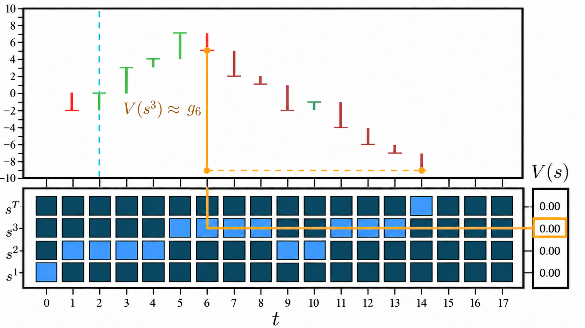

[[_TOC_]]

### Temporal Difference Learning

We can think of temporal difference (TD) learning as an adjustment to the policy-evaluation part of the on-policy constant-$\alpha$ Monte Carlo algorithm covered in `06_monte_carlo_and_off_policy_methods.md`.

We know that  many reinforcement learning algorithms follow generalised policy iteration (GPI), which involves two interacting processes:

- **Policy evaluation:** Estimate the value function for the current policy.
- **Policy improvement:** Use those estimates to improve the policy.

In Monte Carlo (MC) evaluation, we must wait until an episode finishes before we know the complete sampled return $g^{m}_{t}$ and can update a value estimate. This can make learning slow when episodes are long, even though the transitions and rewards observed along the way already contain useful information.

TD learning allows us to update estimates before an episode ends. Instead of waiting for the full return, we use the rewards observed over the next few steps and an estimate of the return beyond them. This is called bootstrapping: updating one estimate using another estimate.

This can allow policy evaluation—and, when combined with a separate policy-improvement step, policy improvement—to happen sooner. However, bootstrapping introduces a trade-off: because the target depends on our current, potentially inaccurate value estimates, TD updates can be biased.

#### n-step Temporal Difference Learning

  
  

    <small><em>Figure: Visualisation of an episode and state-value estimates.
    Image taken from <a href="https://www.youtube.com/watch?v=AJiG3ykOxmY&amp;t=353s">Mutual Information (2022) — Temporal Difference Learning (including Q-Learning)</a>, at 5:53.</em></small>
  

With n-step TD learning, we look ahead $n$ transitions from the current time step $t$. We use the rewards observed during those transitions, then estimate the remaining return using the value of the state reached at $t+n$.

For example, in the figure, suppose we want to update the value of the state visited at $t=2$, which is $s^{2}$. If $n=4$, we wait until $t=6$ and write the complete return from $t=2$ as:

$$
g_{2}=r_{3}+\gamma r_{4}+\gamma^{2}r_{5}+\gamma^{3}r_{6}+\gamma^{4}g_{6}
$$

At $t=6$, we know the rewards $r_{3},r_{4},r_{5},r_{6}$, but we do not yet know the rest of the episode's return, $g_{6}$.

In the figure, the state at $t=6$ is $s^{3}$. Rather than waiting to observe $g_{6}$, we use our current estimate $V(s^{3})$ of the **expected** return from that state. Note that this does not mean $V(s^{3})$ equals the actual return $g_{6}$ for this particular episode.

Our **4-step TD target** therefore becomes:

$$
g_{2:6}=r_{3}+\gamma r_{4}+\gamma^{2}r_{5}+\gamma^{3}r_{6}+\gamma^{4}V(s^{3})
$$

We can now update $V(s^{2})$ without waiting for the episode to finish.

#### Updating the value estimate

Recall the constant-$\alpha$ Monte Carlo update for episode $m$:

$$
V(s^{m}_{t})\leftarrow V(s^{m}_{t})+\alpha\left(g^{m}_{t}-V(s^{m}_{t})\right)
$$

For n-step TD learning, we replace the complete return $g^{m}_{t}$ with the n-step TD target:

$$
g^{m}_{t:t+n}=r^{m}_{t+1}+\gamma r^{m}_{t+2}+\cdots+\gamma^{n-1}r^{m}_{t+n}+\gamma^{n}V(s^{m}_{t+n})
$$

Therefore, our update becomes:

$$
\boxed{V(s^{m}_{t})\leftarrow V(s^{m}_{t})+\alpha\left(g^{m}_{t:t+n}-V(s^{m}_{t})\right)}
$$

The target combines observed discounted rewards over the next $n$ steps with the **discounted estimated value** of the state reached after those steps.

If the episode terminates before $t+n$, we include only the rewards up to termination and omit the bootstrapped value term. There is no remaining future return to estimate after a terminal state.

#### Choosing n

The value of $n$ determines how far ahead we observe rewards before updating:

- **$n=1$:** We observe one reward and the next state, then update. This is one-step TD, also called TD(0). We do not need to wait for the episode to end.
- **$n>1$:** We observe up to $n$ rewards before updating, then bootstrap from $V(s^{m}_{t+n})$ if the episode is still running.
- **$n$ at least as large as the number of steps remaining in an episode:** We observe the complete remaining return, so the target becomes the Monte Carlo return. This is often described informally as the $n\rightarrow\infty$ limit for episodic tasks.

In general, smaller $n$ allows earlier updates but relies more heavily on bootstrapping, whereas larger $n$ uses more observed rewards but requires us to wait longer. This creates a bias–variance trade-off between TD and Monte Carlo targets.
