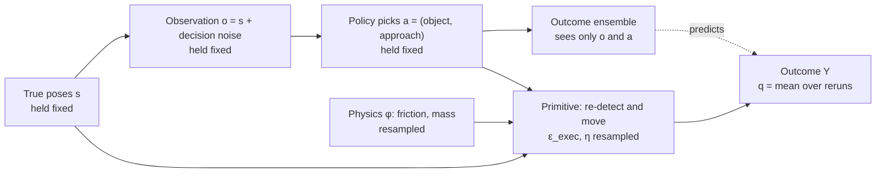

# Final proposal: is ensemble disagreement a failure detector or a novelty detector?

Oct 27, 2026 · @Daniel

The project asks one question: when a skill-level RL manipulation policy meets more clutter than it was trained on, does ensemble disagreement (the epistemic term of the paper's Eq. 1) flag actions that will **fail**, or scenes that merely look **new**? MaskablePPO, failure-detection benchmarks and interventions all support that question. This proposal merges the first plan with the review feedback and supersedes Part 2 onwards of the earlier planning document (*FYP Research Plan: Uncertainty-Gated Intervention for RL Manipulation in Clutter*).

## 1. Research question and hypotheses

**Research question.** In cluttered tabletop pick-and-place, a policy chooses a target object and a grasp approach from noisy object observations. Under clutter beyond the training range, does ensemble disagreement about the action's outcome track the action's **true failure probability**, the outcome model's **error**, or the scene's **novelty**? And does adding disagreement to predicted failure probability improve failure detection and intervention?

The three candidate targets for disagreement are defined precisely in Section 2: true failure probability 1 − q, model error (p̄ − q)², and novelty (design condition, plus an ensemble-independent nearest-neighbour distance ν).

### Primary hypothesis (confirmatory, one test)

**H1 — Disagreement responds to novelty at fixed risk.** Among decisions with the same true failure probability, U\_epi is higher for out-of-distribution (OOD) clutter than for in-distribution (ID) clutter.

- *Data:* the **measured set** (Section 2.5): decisions from ID scenes (0–4 distractors) and OOD-density scenes (6–8 distractors), each with q estimated from M counterfactual rollouts.
- *Statistic: caliper-matched probability of superiority.* Each OOD decision is matched, with replacement, to every ID decision whose q̂ lies within 0.05 of its own, about one binomial standard error at M = 100. For each OOD decision, take the fraction of its matches with lower U\_epi (ties count one half). A is the mean of those fractions. A = 0.5 means no novelty effect. Matching is redone inside every bootstrap replicate, after the binomial redraw of q̂.
- *Overlap requirement:* at least 100 matched OOD decisions. Unmatched decisions are counted and reported, not silently dropped.
- *Smallest effect of interest:* A = 0.56, roughly a standardised difference of 0.2.
- *Decision rule:* **supported** if the 95% CI lies above 0.5 and A ≥ 0.56; **no meaningful novelty effect** if the CI lies inside (0.44, 0.56); otherwise **inconclusive**.
- *Robustness (descriptive):* (i) a rank regression of U\_epi on a natural spline of q̂ plus a condition indicator; (ii) matching on the ensemble's p̄ instead of q̂; (iii) the coarse four-stratum version. A conclusion that changes between these is reported as fragile.

H1 alone does not say whether that disagreement is *warranted*. H2 settles that.

### Supporting hypotheses

| ID | Hypothesis | Direction | Test | Supported if |
| --- | --- | --- | --- | --- |
| H0 (premise) | Task success falls and true failure probability rises under OOD clutter | One-sided | Paired success difference ID vs OOD on shared scenes; mean 1 − q̂ by condition | CI of the drop excludes 0 |
| H2 (warranted disagreement) | (a) At matched q, model error is larger OOD; (b) within OOD, U\_epi ranks decisions by model error | One-sided each | (a) Stratified difference in bias-corrected error ê; (b) Spearman ρ(U\_epi, ê) | (a) CI > 0; (b) CI > 0 |
| H3 (failure detection) | Signals containing disagreement detect realised failures differently from P̂\_fail | **Two-sided** | Paired ΔAUROC vs P̂\_fail for U\_epi, R\_1 and the pessimistic score m, on OOD | CI excludes 0 (either sign is a finding) |
| H4 (intervention) | At a matched intervention budget with a common fallback, triggers differ in task success | **Two-sided** | Paired success difference vs the P̂\_fail trigger at 10% budget, OOD | CI excludes 0 (either sign) |
| H5 (optional) | Ensemble construction (disjoint splits vs bootstrap) changes H1/H2 | Two-sided | Repeat H1/H2 | Non-overlapping CIs |

**Not assumed:** neither the combined score R\_λ nor the pessimistic score m is assumed better than P̂\_fail. Both enter H3 and H4 as two-sided comparisons. The λ grid is a **sensitivity analysis**, not a tuned winner (Section 3.5).

### How H1 and H2 combine

|  | Error rises OOD (H2 supported) | Error does not rise OOD |
| --- | --- | --- |
| **Disagreement rises OOD (H1 supported)** | Disagreement is *warranted caution*: it signals real ignorance | Disagreement is a *false-alarm novelty detector* |
| **Disagreement flat** | Ensembles are *confidently wrong* under shift | The shift is benign for the outcome model |

Every cell is a publishable finding. This table is the backbone of the results chapter.

### Multiple comparisons

H1 is the single confirmatory test, at α = 0.05. H0, H2a, H2b, and the three H3 comparisons and one H4 comparison listed above are corrected together with Holm–Bonferroni. Everything else is reported as descriptive or exploratory, with intervals but no significance claims. This list is frozen in a dated pre-registration file before any test-set run (milestone G-pre, 7 February).

## 2. What "true failure probability" means

MuJoCo is deterministic: the same full physical state and the same control inputs give the same outcome every time. So a "true probability" exists only for an explicitly named set of random factors. Below, every source of randomness is a separate seeded stream, and the estimand says exactly which streams are resampled and which are held fixed.

### 2.1 Sources of randomness

| Factor | Symbol | Model (starting values, tuned in E0) | Drawn when | In counterfactual rollouts |
| --- | --- | --- | --- | --- |
| Scene layout: object poses, sizes, overhang | s₀ | Procedural generator from the scene seed | Episode start | **Fixed** (snapshot of current true poses s) |
| Physical parameters per object | φ | Friction μ \~ U(0.5, 1.0); mass and inertia scaled by U(0.8, 1.2) | Episode start, persistent | **Resampled** from the same prior |
| Decision-time observation noise | ε\_dec | x, y \~ N(0, (5 mm)²); yaw \~ N(0, (3°)²), independent per object | Each decision | **Fixed** (o is what the decision saw) |
| Execution-time pose estimate of the chosen object | ε\_exec | Same distribution as ε\_dec, **independent draw** | When the primitive starts | **Resampled** |
| Actuation noise on each Cartesian waypoint | η | Position N(0, (2 mm)²), yaw N(0, (1°)²) | Each waypoint | **Resampled** |
| Robot and controller state at decision time | — | Canonical home pose, zero velocity, controller goal reset | Each decision | **Fixed** (identical by construction) |

Two design choices make the estimand clean without adding architecture:

- **Re-observe before executing.** The primitive does not reuse the decision observation. It takes a fresh pose estimate of the chosen object (ε\_exec), as a robot re-detecting an object at close range would. The outcome therefore depends on the true state and the execution randomness, but not on the decision noise ε\_dec.
- **Canonical decision state.** After every primitive, the environment lets objects settle (0.25 s), records the true object poses, then calls mj\_resetData (clearing velocities, controls, actuator state and the solver warm-start that MuJoCo otherwise carries between steps), writes back the recorded object poses including orientation, puts the robot and open gripper at their exact home configuration and resets the controller goal. Every decision, in a real episode or a counterfactual one, starts from a state fully described by the object poses. Replaying a decision needs no access to robosuite's internal controller state.

### 2.2 Three quantities that must not be confused

Write Y = 1 for success, F = 1 − Y for failure, and x = (s, φ, robot at home) for the full hidden state. Here s is the scene geometry (every object's pose and size), not the full physical state: φ varies separately, and training and the rollouts use the same φ prior. The simulator is a deterministic function:

```latex
Y = g\big(s,\ \varphi,\ a,\ \varepsilon_{\text{exec}},\ \eta\big) \in \{0, 1\}, \qquad o = h(s) + \varepsilon_{\text{dec}}
```

**(1) The realised outcome Y\_t.** One draw. Used for failure-detection AUROC (H3) and task success (H0, H4).

**(2) State-conditional success probability q(s, a).** The probability of success given the true geometry, averaging over everything the robot cannot know or control at that moment:

```latex
q(s, a) = \Pr(Y = 1 \mid S = s,\ A = a) = \mathbb{E}_{\varphi \sim \Phi,\ \varepsilon_{\text{exec}},\ \eta}\big[\, g(s, \varphi, a, \varepsilon_{\text{exec}}, \eta) \,\big]
```

This is what counterfactual rollouts estimate. It conditions on the exact true poses, which the robot never sees.

**(3) Observation-conditional success probability p\*(o, a).** The Bayes-optimal target of the outcome model, which only sees o:

```latex
p^{*}(o, a) = \Pr(Y = 1 \mid O = o,\ A = a) = \mathbb{E}\big[\, q(S, a) \mid O = o \,\big]
```

The gap between (2) and (3) comes only from not knowing the true poses given the noisy observation. By the law of total variance, the irreducible outcome variance splits into two parts:

```latex
p^{*}(1 - p^{*}) = \underbrace{\mathbb{E}\big[q(1-q) \mid o\big]}_{\text{execution randomness}} + \underbrace{\operatorname{Var}\big[q(S,a) \mid o\big]}_{\text{state uncertainty}}
```

Both parts are aleatoric from the outcome model's point of view: no amount of training data removes them. That is why U\_ale is compared with U\_epi in every analysis.

**Assumptions to state in the report:**

- **A1.** φ is independent of the observation, so its posterior equals its prior. This holds because φ is drawn once and never observed, ignoring the weak information earlier slips carry. The outcome model sees only the current o, not the history. Consequently q is the success probability under the specified randomisation of φ. It is not the failure probability in the current episode, where φ is already fixed and may be partly revealed by earlier slips. If that episode-specific value is ever needed, rerun with the episode's own φ at the same cost.
- **A2.** The shift is approximately pure covariate shift. Strictly, p(s | o) depends on the scene prior, which differs between ID and OOD. With 5 mm noise the likelihood dominates, so p\*(o, a) is close to the same function in both conditions. The only intended difference between conditions is the number of distractors.



*Counterfactual rollouts fix the layout and rerun only the hidden randomness.* Rollouts hold s, o, a and the robot's home pose fixed, and resample φ, ε\_exec and η. q(s, a) is the mean of Y over rollouts, conditional on the true layout the robot never sees. p\*(o, a) = E[q(S, a) | o] is the best any outcome model can learn from o alone.

Decision noise reaches the outcome only through the choice of action, never through execution. That is what lets a rerun from the snapshot estimate q exactly.

### 2.3 How a counterfactual rollout works

For a recorded decision (snapshot s, action a), rollout r = 1, …, M does the following:

1. Restore the canonical state. Call mj\_resetData (the same routine the real episode uses), then set every object's free-joint pose from the snapshot and the robot and gripper to home, call mj\_forward, and reset the controller goal.
2. Draw φ⁽ʳ⁾, ε\_exec⁽ʳ⁾ and η⁽ʳ⁾ from streams seeded by (scene seed, decision index, r). Write φ into the model arrays (geom\_friction, body\_mass, and body\_inertia scaled by the same factor). Restore the originals afterwards.
3. Execute the primitive for a and record Y⁽ʳ⁾ plus the failure flags.

No XML is recompiled: all J\_max = 10 object bodies are loaded once, and unused ones sit on a parking platform out of the robot's reach.

**Determinism and fidelity tests (part of gate G1):**

- *Determinism:* the same snapshot and seed run twice in one process give identical Y and final object poses to within 10⁻⁹ m. Run MuJoCo single-threaded per process and parallelise across processes. Bitwise equality is only guaranteed for the same build on the same CPU type, so run all replays of one experiment on one machine type.
- *Replay fidelity:* replaying a real episode's decision with that episode's own φ and seeds reproduces the realised Y in 100% of 200 test decisions. With canonical decision states this should hold exactly; any mismatch is a bug.
- *Genuine randomness:* across different seeds, some decisions must have intermediate q̂. Gate G2 requires at least 10% of measured-set decisions to have q̂ ∈ \[0.1, 0.9\]. If almost every q̂ is 0 or 1, the outcomes are effectively deterministic given geometry; widen η or φ in E0, before any test data exists.

Common random numbers: when comparing two actions in the same state (the proposed action against the fallback for intervention value), use the same rollout seeds for both. Their difference then has far lower variance.

### 2.4 Sampling uncertainty: how many rollouts?

With k successes in M rollouts, q̂ = k / M and Var(q̂) = q(1 − q) / M. Report each q̂ with a Jeffreys interval, Beta(k + ½, M − k + ½).

| Rollouts M | 95% half-width at q = 0.5 | at q = 0.1 | Verdict |
| --- | --- | --- | --- |
| 10 | ±0.31 | ±0.19 | Too coarse: cannot separate 0.3 from 0.7 |
| 50 | ±0.14 | ±0.08 | Minimum if throughput is very low |
| **100** | **±0.10** | **±0.06** | **Default** |
| 200 | ±0.07 | ±0.04 | If throughput allows |
| 400 | ±0.05 | ±0.03 | Only for a small diagnostic subset |

M is fixed in advance for every decision. Adaptive top-ups based on the first rollouts bias q̂ slightly, so they are allowed only in descriptive plots.

**Is M large enough?** Report each q̂ with its Jeffreys interval, and carry binomial uncertainty into every conclusion through the bootstrap below. Adequacy is judged by stability: compare the H1 and H2 intervals from the bootstrap with and without its binomial level. If adding that level widens either interval by more than 20%, raise M to 200. Split-half reliability is a diagnostic only, computed on decisions with q̂ ∈ \[0.1, 0.9\]: decisions at 0 or 1 inflate it while saying nothing about intermediate probabilities.

**Bias-corrected model error.** The naive squared error against q̂ is inflated by sampling noise. This estimator is unbiased for the squared error against q:

```latex
\hat{e} = (\bar{p} - \hat{q})^{2} - \frac{\hat{q}(1 - \hat{q})}{M - 1}, \qquad \mathbb{E}[\hat{e}] = (\bar{p} - q)^{2}
```

**Assumptions:** the M rollouts are independent Bernoulli(q) draws (independent seeds, same geometry and action); p̄ does not depend on them; M ≥ 2. **Derivation:** E\[(p̄ − q̂)²\] = (p̄ − q)² + q(1 − q)/M, and E\[q̂(1 − q̂)\] = q(1 − q)(M − 1)/M, so the correction term has expectation q(1 − q)/M. ê can be negative for a single decision, which is fine for averages and ranks.

There is **no** unbiased estimator of the absolute error |p̄ − q| from binomial data. Only polynomials in q of degree at most M have one, and |p̄ − q| is not a polynomial. The project therefore uses squared error only.

**The state-uncertainty floor.** Measured against q rather than p\*, even a perfect outcome model has error:

```latex
\mathbb{E}\big[(\bar{p} - q(S,a))^{2} \mid o\big] = (\bar{p} - p^{*})^{2} + \operatorname{Var}\big[q(S,a) \mid o\big]
```

The floor adds the same term to every predictor's expected squared error, so it cancels when two predictors' mean squared errors are compared on the same decisions. It does **not** cancel when signals are correlated with error, as in H2b. Var\[q(S, a) | o\] is largest near grasp boundaries, where U\_tot and U\_epi also tend to be high, so a signal can appear to track model error when it is really tracking irreducible state ambiguity. The floor may also differ between ID and OOD. Three consequences follow:

- ê is called the *error against geometry-conditional success*, never the ensemble's prediction error. Prediction quality is judged on realised outcomes (H3). Correcting the expected error does not make each ê reliable for ranking, so correlations involving ê always carry the binomial level of the bootstrap.
- **A core floor check is part of E3.** Take 25 decisions per condition. For each, draw 10 plausible geometries s′ \~ p(s | o) by perturbing the observed poses with the noise model and rejecting interpenetrating samples. Estimate q(s′, a) with M = 40 each, which is 20,000 rollouts in total. Var\[q | o\] is the between-geometry variance of q̂ minus the mean binomial term q̂(1 − q̂)/(M − 1). H2 is always stated relative to geometry-conditional success. H2a is reported as not identifiable if the floor differs between conditions by more than the measured error difference. A larger version (E6c) is optional.
- Matching on q is not matching on p\*. So H1 is repeated with matching on the ensemble's own p̄ as a robustness check. A novelty effect that appears under one matching and not the other is reported as fragile.

**Uncertainty propagation.** All intervals come from one hierarchical bootstrap with three levels: training seeds (5), then scenes within condition (the cluster unit, since decisions in one episode are dependent), then a binomial redraw q̂\* \~ Binomial(M, q̂) / M per decision, after which strata are rebuilt. Use 2,000 replicates and percentile intervals.

### 2.5 The measured set, and what it costs

The measured set is the only place q is estimated. Its decisions come from no-intervention rollouts: on pilot scenes for the MVP in January, and on the frozen test scenes only after pre-registration in February. The full tier uses 300 decision states per condition (ID, OOD-density). For each state, q is measured for three actions:

1. the policy's proposed action;
2. one uniformly random other valid action, so the set covers risky actions the policy rarely picks;
3. the fallback's action, for the offline intervention analysis in E5.

The primary H1 analysis pools actions 1 and 2, as fixed in advance.

q depends on the environment and the action, **not on any trained model**. So q is measured once and all five ensemble seeds are scored on the same decisions, which makes seed replication cheap.

**Cost:** 600 states × 3 actions × M = 100 gives 180,000 primitive executions. At a measured 2 executions per second per core on 12 cores, that is about 2.1 hours; at 0.5 per second, about 8.3 hours. Measure throughput in week 1, then commit a tier in the pre-registration: the minimum is 200 states × 2 actions (80,000 rollouts) and the full set is 300 × 3 (180,000). E5's grid is trimmed the same way: the confirmatory cell (rate-matched, b = 10%, OOD) comes first, and other cells only as compute allows.

## 3. System design

There are five components, each replaceable without touching the others: a robosuite environment with scripted primitives; an object-centric observation; a MaskablePPO policy; a five-member outcome ensemble that produces the signals; and a geometric fallback that knows nothing about any signal.

### 3.1 Environment

| Element | Choice | Reason |
| --- | --- | --- |
| Simulator | robosuite 1.5 on MuJoCo, version pinned | Tested Panda model and OSC controller; CPU-fast contacts |
| Robot | Franka Panda, parallel-jaw gripper, OSC\_POSE controller | Best-supported robosuite arm |
| Workspace | About 60 × 60 cm table; fixed goal zones and a staging zone, always kept clear | Placement is not the research question |
| Targets | 1 (MVP) or 1–2; blocks about 4 × 4 × 8 cm | Graspable by both top and side approaches |
| Distractors | 4–6 cm wide, 8–12 cm tall; height-to-width ratio at most 2.5 | Tall enough to block side corridors; short enough not to topple easily |
| Overhang | A horizontal bar over part of the table in 50% of scenes | Blocks top grasps beneath it, as in the paper's "roof clash" |
| Approaches | 𝒢 = {top, left, right}, indexed by m ∈ 𝒢; front only if it validates | Three are enough to make the choice matter |
| Object bodies | J\_max = 10 pre-loaded; unused ones parked off-reach | No recompiles; fast resets and replays |

**Primitive for action (j, m):** take a fresh pose estimate of object j (ε\_exec); move to a pre-grasp pose 10 cm back along approach m; move in; close; lift 10 cm; retreat along the approach line; carry the object to its goal (target) or the staging zone (distractor); release; return home; settle. Waypoints get actuation noise η, and every stage has a tolerance and a timeout. Side approaches tilt 10–15° downward if E0 shows the hand hitting the table.

**Outcome label:** Y = 1 if the intended placement succeeded with no disqualifying event. Disqualifying events are: a target dropped or missed, any object leaving the table, an object displaced by more than 3 cm, or a timeout. Separate, non-exclusive flags are stored for analysis: grasp\_miss, slip, collision\_object, collision\_environment, knocked\_off, displaced, timeout. A collision that does not disqualify is flagged but still counts as success.

**Scene descriptors,** computed from the true state for analysis only: D (number of distractors), c (distractors within 12 cm of a target), b (number of a target's approaches whose swept corridor intersects an object or the overhang), and *relocation-required* (every approach to some target is blocked by a movable distractor).

### 3.2 Observation and encoder: every object, relative to the candidate

Each candidate object j is described together with **every** other object, in j's own frame. A shared network encodes each (j, k) pair, and the pair encodings are summed and then normalised. The input therefore never drops part of the scene, and its scale never grows with the number of objects. This is the linear relation network design of [Mambelli et al. (2022)](https://ar5iv.labs.arxiv.org/html/2201.13388), which is a target-conditioned form of [Deep Sets](https://papers.nips.cc/paper/6931-deep-sets). The ensemble and the policy each use their own copy of it.

| Part | Features | Dims |
| --- | --- | --- |
| Own features own\_j | Size (w, d, h): 3; sin 4ψ̂ and cos 4ψ̂ (square cross-sections repeat every 90°): 2; target or distractor: 1; placed flag: 1; planar position (x, y) relative to the robot base: 2; goal position relative to the object (zeros for distractors): 2; targets remaining and decisions remaining: 2; corridor clearance for top, left and right, computed from the observed poses of all elements and clipped to 0–10 cm: 3 | 16 |
| Pair features r\_jk, for every other element k | Relative (dx, dy) in j's frame; size (w, d, h); type one-hot (target, distractor, overhang); present flag | 9 |

The overhang is one more element in the set: its nearest edge fills (dx, dy), and its depth and clearance height fill the size slots. With J\_max = 10 object bodies plus the overhang, the network sees a padded 11-element set. The environment returns one feature row per element plus the task features, and the network builds the pairs with tensor operations.

```latex
e_j = \operatorname{LayerNorm}\Big(W \sum_{k \neq j} \mu_k \, f_{\text{pair}}\big(\mathrm{own}_j,\ r_{jk}\big) + b\Big), \qquad h_j = \rho\big([\mathrm{own}_j,\ e_j]\big)
```

Here μ\_k is 1 for a real element and 0 for padding, and W and b form a learned linear layer before the LayerNorm, as in Mambelli et al. f\_pair and ρ are MLPs with two hidden layers of 64 units. The embedding size d of e\_j and h\_j defaults to 32, chosen from {16, 32, 64} on ID validation loss only. Mambelli et al.'s ablation found that both a very small (10) and a large (100) embedding generalised worse to more objects, so larger is not safer.

**Why this form, and not the alternatives:**

- **Nothing is invisible.** Every object enters, so an obstacle outside the four nearest still counts. Failures under clutter can no longer come from the representation hiding obstacles.
- **Scale is controlled, but shift is not removed.** A plain sum grows with object count, which the ensemble could read as novelty purely because of the encoding. A mean dilutes nearby obstacles with distant ones, and it generalised worse in Mambelli et al.'s ablation. The sum, linear layer and LayerNorm keep the magnitude stable. But LayerNorm is scale-invariant, so it also discards information: if every added object contributed the same relation vector r, LN(3r) = LN(8r). It guarantees neither generalisation to more objects nor that everything relevant to success survives. So the per-approach clearance features carry the physically relevant aggregate directly, and the pilot checks below measure what the embedding keeps instead of assuming it.
- **Why clearance and not object count.** Leaving out an explicit count is a design decision, not a necessity. Novelty from an unseen count is genuinely part of the shift, and H2 is what judges whether it matters. The choice is an inductive bias towards physical relationships, and it avoids a single input whose values at 6–8 distractors would be pure extrapolation. It does not make the model count-invariant: the summed relations can still encode how many objects there are. Clearance is bounded and should span its range in training; the pilot checks verify that instead of assuming it.
- **Cost.** Mambelli et al.'s encoder is linear in the number of objects because each object is related to one fixed goal. Here every object is a candidate, so scoring all candidates costs O(N²): 10 × (9 + 1) = 100 pair evaluations per scene when all ten objects are present (each candidate against nine other objects and the overhang). That is trivial at this size, but the dissertation should state it this way, not claim linear cost.
- **No attention or graph network.** Mambelli et al.'s self-attention baseline failed when objects were added beyond training. [Set Transformer](https://mlanthology.org/icml/2019/lee2019icml-set/) and graph networks such as [Huang et al. (2023)](https://arxiv.org/pdf/2209.11943) add machinery the research question does not need.

**Two fixed descriptors** are computed for every decision. Neither is ever an input to the main model.

- **Four-neighbour descriptor d(o, a):** own features (11), four nearest neighbours × (dx, dy, w, d, h, type, present) (28), overhang (3), task (2) and one-hot(m) (3), 47 dimensions. Used for the E6d ablation encoder and for logging, from the true geometry, whether an object obstructing the chosen corridor lies outside the four neighbours (an *omitted obstructer*).
- **Whole-scene descriptor for the novelty score ν:** the candidate's own features, per-approach clearance, the number of objects within 12 cm and within 25 cm of the candidate, the four smallest neighbour distances, the total object count, and the overhang offset. ν has to register added objects even where the four-neighbour descriptor would hide them. Two versions are reported: ν\_full uses all of these, and ν\_geo drops the total count and the within-radius counts. Total count alone separates the ID and OOD ranges perfectly, so ν\_geo shows whether a scene is novel in its arrangement rather than just its count. Neither feeds the ensemble.

**Architectural unit tests (must always pass):**

- Permuting the objects permutes the policy's logits identically and leaves outcome predictions unchanged.
- Adding padded or parked elements changes nothing.

**Post-training diagnostics** test learned behaviour, so they are not guaranteed to pass and are reported, not enforced:

- Moving an obstacle into the chosen approach corridor should lower p̄ for that approach. If it does not, the model is ignoring the other objects.
- Adding a distractor more than 30 cm from every corridor of the candidate should barely change p̄ for an otherwise identical grasp. Flag changes above 0.05: a model that reacts to clutter it should ignore would produce exactly the artefact H1 must not pick up.

**Pilot checks before freezing the representation:**

- **Observable shift.** Compare ν\_full, ν\_geo, and the distance from each e\_j to its nearest training embeddings, between ID and OOD pilot scenes. If the embedding barely moves while ν does, the encoder is absorbing the shift. Report that either way, because it decides how H1 is read: low disagreement under shift may mean good generalisation, not a blind ensemble.
- **Clearance coverage.** Histogram per-approach clearance (computed from noisy observations) in training and OOD pilot scenes, and report the share of OOD values outside the training range.
- **Count generalisation.** On pilot scenes, compare ensemble accuracy at D = 6–8 against D = 0–4. Mambelli et al.'s evidence comes from a different robot and task, so it shows this design *can* extrapolate to more objects, not that it will here.

### 3.3 Policy: MaskablePPO with a shared per-object scorer

The policy has its own copy of the encoder from Section 3.2, and the same small head scores every object, so no output position is tied to a slot:

```latex
\ell_{j,m} = f_{\pi}(h_j)_m, \qquad \pi(j, m \mid o) = \operatorname{softmax}_{(j,m)\,\in\,\text{valid}}(\ell_{j,m}), \qquad V(o) = f_V\Big(\operatorname{LayerNorm}\big(\textstyle\sum_j \mu_j\, h_j\big)\Big)
```

f\_π and f\_V are MLPs with two hidden layers of 64 units. Invalid actions (parked or already-placed objects) are masked. The value function pools with the same sum and LayerNorm, for the same reason as the encoder.

**Implementation in sb3-contrib** (budget 3–4 days): subclass MaskableActorCriticPolicy. A custom features extractor reshapes the flat observation into the element table, builds the pairs, and returns the 30 logits plus the pooled value features. Override \_build so action\_net is an identity map. The unit tests in Section 3.2 apply.

*Fallbacks, in order, if this proves awkward:* (1) the same per-object head on the fixed four-neighbour descriptor (the E6d encoder); (2) a flat MLP on all objects, with objects scattered across the 10 slots at random at every reset, as long as every slot is used in training.

**Training:** a contextual-bandit stage first (single target, one decision), then multi-step episodes with relocation. Hyperparameters start from sb3 defaults (learning rate 3 × 10⁻⁴, n\_steps 2048 across 8 environments, batch 256, γ = 0.97). The decision budget per run comes from the throughput measurement:

```latex
T_{\text{train}} \approx \frac{N_{\text{decisions}}}{\text{decisions per second per core} \times \text{cores}}
```

**Reward:** 1 for each target placed, 2 more when all are placed, −0.1 for a failed action, −0.2 per collision flag, −1 if an object is knocked off, and −0.02 per decision. Coefficients are fixed after a pilot and never changed afterwards.

### 3.4 Outcome ensemble

- **Input:** the candidate's own features, its pair features with every other element (Section 3.2), and one-hot(m). **Output:** p\_k(o, a) = σ(g\_k(\[h\_j, one-hot(m)\])), where g\_k is an MLP with two hidden layers of 64 units.
- K = 5 members. Each has its own encoder and head, with no shared weights, so disagreement reflects the whole network. Diversity comes from bootstrap resampling plus independent initialisation. Binary cross-entropy, Adam at 10⁻³, early stopping on ID validation loss. Each member has roughly 20,000 parameters.
- **Data:** ID scenes only. A 50/25/25 mix of uniform random valid actions, heuristic actions and PPO actions. Before PPO exists, the mix is 67/33 random and heuristic. About 50,000 labelled decisions; check the learning curve and stop when validation loss plateaus. The final dataset is frozen at the pre-registration gate.

### 3.5 Signals

With H\_b(p) = −p log p − (1 − p) log(1 − p):

| Signal | Definition | Role |
| --- | --- | --- |
| P̂\_fail | 1 − p̄, where p̄ = (1/K) Σ p\_k | Risk-only baseline |
| U\_tot | H\_b(p̄) | Total predictive uncertainty |
| U\_ale | (1/K) Σ H\_b(p\_k) | Expected within-member uncertainty |
| U\_epi | U\_tot − U\_ale | The paper's Eq. 1 on outcomes: binary Jensen–Shannon divergence |
| σ\_ens | Standard deviation of the p\_k | Disagreement on the probability scale |
| R\_λ | P̂\_fail + λ σ\_ens, for λ ∈ {0, 0.5, 1, 2, 4}; reference value λ = 1 | Combined risk and disagreement |
| m | max\_k (1 − p\_k) | Pessimistic member, parameter-free |
| ν | Mean standardised distance from the whole-scene descriptor (Section 3.2) to its 10 nearest training descriptors, reported as ν\_full and ν\_geo | Novelty reference, independent of the ensemble |
| Random | Uniform(0, 1) | Negative control |

Three notes on these signals:

- **Why the λ grid is fixed in advance.** If ID failures are mostly random slips, a λ tuned on ID validation will drift towards 0, and R\_λ would collapse into P̂\_fail before it ever meets shift. So the full curve over the grid is reported. λ = 1 is designated in advance as the single value carried into confirmatory tests, and the ID-validation-selected λ is reported separately.
- **m and R\_λ are related but not the same.** If member predictions were roughly normal, the expected maximum of 5 draws is about 1.16 standard deviations above the mean, so m ≈ R\_1.16. Differences between them reflect skewed disagreement, such as one alarmed member.
- **ν turns the "novelty" side of the question into a measurable baseline.** If U\_epi behaves like ν as a trigger, that is direct evidence it is acting as a novelty detector.

### 3.6 Fallback and gate

**Fallback (geometric heuristic), fixed and independent of every signal.** From the observations, compute each (target, approach) corridor's clearance. Choose the target action with the largest clearance, provided it exceeds the gripper width plus 1 cm. Otherwise, relocate the observed distractor that intrudes most into the best corridor. When triggered, the fallback executes its best action **other than the proposed one**. Log how often its first choice equalled the proposal.

**Gate:** intervene when score(o, a) > τ. Thresholds are set in two ways:

- *Rate-matched:* τ is the (1 − b) quantile of the score on separate calibration scenes for that condition, using scores only, never outcomes.
- *Deployed:* τ is set on ID calibration scenes and applied unchanged under shift; report the realised intervention rate.

**Removed from the first plan** because the research question does not need them: the Transformer encoder, the ensemble DQN, Q-value signals, seven-way outcome entropy, the oracle supervisor (now optional) and the OOD-pattern axis.

## 4. Experiments

E0 validates the environment and the estimand. E3 is the central experiment. E1, E2, E4 and E5 support it, and E6 is optional. All test scenes come from seed ranges never used in training, validation or calibration.

| Split | Distractors D | Use | Opened |
| --- | --- | --- | --- |
| Development / pilot | 0–8 | Debugging, difficulty tuning, the January MVP, exploring uncertainty behaviour | Any time, as often as needed |
| Train | 0–4 | PPO, outcome-ensemble data | Any time |
| Validation | 0–4 | Checkpoints, early stopping, λ reported by validation | Any time |
| Calibration | 0–4 and 6–8 | Intervention thresholds (scores only) | Any time |
| Test-ID | 0–4 | All confirmatory ID results | Only after pre-registration, 7 February |
| Test-buffer | 5 | Descriptive only, to show where the transition happens | Only after pre-registration |
| Test-OOD | 6, 7, 8 | All confirmatory OOD results | Only after pre-registration |

Environment settings (noise levels, φ ranges, clutter levels, object sizes) may change freely on pilot scenes. They are frozen at pre-registration, and the test seed ranges are never used before then.

### E0 — Environment and estimand validation (gates G1, G2)

**Procedure:**

1. Run each approach 100 times on an unobstructed target.
2. Block each corridor in turn and confirm the failure is physically sensible on video.
3. Run the determinism, replay-fidelity and randomness tests from Section 2.3.
4. Run the naive BT, heuristic and random policies on 200 scenes per D level.
5. Measure throughput (primitives per second per core) and q̂ on a 100-decision pilot.
6. Watch 20 videos per failure flag and check the labels.

**Pass criteria:**

- At least 95% success per approach on easy scenes.
- Determinism holds to 10⁻⁹ m, and replay fidelity is 100%.
- At least 10% of pilot decisions have q̂ ∈ \[0.1, 0.9\].
- The heuristic's success exceeds the naive BT's by at least 15 points at D = 4 (the task is not trivial).
- The heuristic's success is at least 60% at D = 0–4 (the task is not impossible).
- At least 19 of 20 audited labels are correct.

### E1 — Does RL learn useful sequential behaviour? (supporting)

- **Compare:** MaskablePPO; naive BT (always top, fixed order); geometric heuristic; greedy one-step policy.
- **The greedy policy, defined on task progress:** execute the target action with the highest p̄ if that p̄ is at least 0.5. Otherwise, relocate the distractor whose removal from the observation most increases the best target p̄ (a one-step lookahead using the outcome model).
- **Measure:** success, decisions per success, collisions per episode, learning curves (5 seeds), and success on the **relocation-required subset**.
- **Interpretation:** if PPO beats greedy on the relocation-required subset (paired CI excludes 0), it has learned sequential behaviour worth calling RL. If not, report that honestly and carry on: E3 does not depend on it.

### E2 — Generalisation under clutter shift (H0)

- **Procedure:** run every policy without interventions on 200 test scenes per D level (identical scenes across policies), for each of 5 seeds. Fit a logistic regression of episode success on D, b and relocation-required.
- **Measure:** success against D, failure flags against D, and the q̂ distribution (from the measured set) by condition.
- **H0 is supported** if the paired success drop from ID to OOD has a CI excluding 0 for the PPO policy.
- **If H0 fails** (no drop), the shift is too weak: on pilot scenes only, raise D to 10 or narrow the workspace, before pre-registration.

### E3 — Novelty or failure? (H1 primary, H2)

**Procedure:**

1. Build the measured set (Section 2.5): pilot scenes for the MVP, frozen test scenes after pre-registration. Use 200–300 decision states per condition from no-intervention rollouts, with q estimated by M = 100 rollouts for the proposed, random and (full tier) fallback actions.
2. Score every (o, a) pair with all 5 ensemble seeds: p̄, U\_epi, U\_ale, U\_tot, σ\_ens and ν.
3. **Check overlap.** Plot q̂ histograms by condition and count the OOD decisions with at least one ID match within the caliper. At least 100 are required.
4. **H1:** compute the caliper-matched probability of superiority A (Section 1), with the hierarchical bootstrap.
5. **H2a:** compute the matched OOD-minus-ID difference in mean ê. **H2b:** compute Spearman ρ(U\_epi, ê) within OOD.
6. **Core floor check:** 25 decisions per condition, 10 plausible geometries each, M = 40 (Section 2.4), to estimate Var\[q | o\] by condition before interpreting H2.
7. Report the observable-shift check (ν and e\_j distributions by condition) and the omitted-obstructer rate, which matters for the E6d ablation.
8. Place the result in the 2 × 2 interpretation table (Section 1).

**Robustness checks (descriptive):** replace U\_epi with σ\_ens; replace the condition with continuous ν; and the three alternative matchings listed under H1.

**False alarms on safe novel decisions:** among OOD decisions with q̂ ≥ 0.95, report the fraction each signal flags at the ID-calibrated 10% threshold. This single number states most directly whether a signal behaves as a novelty detector.

**Controlled:** the decisions scored (identical for every signal), M, the ensemble training data, K.

### E4 — Failure detection on realised outcomes (H3)

- **Procedure:** in E2's no-intervention rollouts, record every decision's signals and realised failure F. Compute AUROC and AUPRC (with the failure base rate shown beside AUPRC) per condition, and a reliability diagram and Brier score for P̂\_fail.
- **Confirmatory comparisons** (OOD, two-sided, Holm-corrected): AUROC of U\_epi, R\_1 and m, each minus AUROC of P̂\_fail. Paired bootstrap over seeds and scenes.
- **Descriptive:** the full λ curve; U\_tot, U\_ale, ν and random; detection rate per failure flag at a 10% false-positive rate.
- **Interpretation:** U\_epi alone is expected to rank poorly, because it is low for confident failures. Whether *adding* disagreement (R\_1, m) helps is the real question.

### E5 — Interventions (H4)

- **Triggers:** none, random, P̂\_fail, U\_epi, U\_tot, R\_1, m, ν. The same fallback is used for all of them.
- **Budgets:** b ∈ {5, 10, 20}%, under both threshold protocols (rate-matched and deployed). 200 OOD test scenes and 200 ID test scenes, 5 seeds, identical scenes across triggers.
- **Measure:** episode success, realised intervention rate, collisions, and decisions per success. Run a λ sensitivity curve at b = 10%.
- **Offline decomposition** on the measured set, which needs no extra episodes. With common random numbers, Δq̂ = q̂(s, a\_fallback) − q̂(s, a\_proposed). For each trigger at budget b, the expected one-step gain is the mean Δq̂ over the decisions it triggers. This splits intervention value into **trigger quality** (does it pick decisions where Δq > 0?) and **fallback quality** (mean Δq over truly failing proposals). It is the direct answer to the confound between trigger and fallback.
- **Confirmatory:** at OOD, rate-matched b = 10%, the success of the R\_1 trigger minus the success of the P̂\_fail trigger (two-sided). Everything else is descriptive.

### E6 — Optional, in priority order

- **E6a, noise-shift contrast.** Raise σ\_exec to 10 mm at D = 0–4. This creates an *aleatoric* shift: failure rises without configurational novelty. The prediction is that U\_epi stays flat. It is a clean mirror image of E3.
- **E6b, ensemble construction (H5).** Compare disjoint data splits (as in the paper) with bootstrap resampling; repeat H1 and H2.
- **E6c, state-uncertainty floor.** A larger version of E3's core floor check (50 decisions per condition, M = 50, 50,000 rollouts), only if the core check is borderline.
- **E6d, representation ablation.** Replace the relational encoder in both networks with the fixed four-neighbour descriptor and a per-object MLP. Do omitted obstructers create confidently wrong failures under clutter, and do H1 and H2 change? This tests whether what the network cannot see is mistaken for a failure of uncertainty estimation.
- **E6e, ensemble size.** K ∈ {3, 5, 10}.

## 5. Variables, baselines and statistics

### Independent variables

| Variable | Levels | Experiments |
| --- | --- | --- |
| Clutter condition (number of distractors D) | ID 0–4; buffer 5; OOD 6, 7, 8 | E2–E5 |
| Acting policy | Naive BT, heuristic, greedy, MaskablePPO | E1, E2 |
| Signal | P̂\_fail, U\_epi, U\_tot, U\_ale, σ\_ens, R\_λ, m, ν, random | E3–E5 |
| λ | 0, 0.5, 1, 2, 4 | E4, E5 (sensitivity) |
| Intervention budget b | 0, 5, 10, 20% | E5 |
| Threshold protocol | Rate-matched, deployed | E5 |
| Optional | σ\_exec; ensemble construction; K; clearance features | E6 |

### Controlled variables (identical across all conditions and methods)

| Variable | Fixed value (finalised in E0) |
| --- | --- |
| Software | robosuite and MuJoCo versions, git commit; single-threaded MuJoCo per process; one machine type per experiment |
| Physics | Timestep, solver settings, φ prior, settle time 0.25 s |
| Noise | σ for ε\_dec and ε\_exec: 5 mm and 3°; η: 2 mm and 1° |
| Geometry | Workspace, goal and staging zones; object size distributions; overhang probability and height range |
| Scene rules | Same generator and the same solvability rule at every D. Solvable means every target has a free approach, or one after relocating a single distractor. Report the rejection rate per D |
| Task | Approaches {top, left, right}; number of targets; decision budget 2 × targets + 3; reward coefficients |
| Learning | PPO hyperparameters and decision budget; ensemble architecture, K = 5, dataset and its size, epochs |
| Intervention | One fallback for all triggers; same calibration scenes |
| Measurement | M = 100; rollout seed derivation; same test scenes for every method |

**What changes with D besides D:** free space and the probability of blocked corridors necessarily change, because that is what clutter is. Report b and relocation-required by condition, so readers can see the composition of each condition.

### Baselines and references

| Role | Baseline |
| --- | --- |
| Policy floor | Naive BT: fixed order, always a top grasp (the paper's baseline) |
| Hand-designed policy | Geometric heuristic (also the fallback) |
| One-step model-based policy | Greedy task-progress policy with relocation lookahead |
| Risk-only trigger | P̂\_fail |
| Novelty-only trigger | ν (kNN distance) |
| Negative control | Random score at the same budget |
| Upper bound (optional) | Hindsight trigger: replay the proposal with its own seeds; intervene exactly when it would fail. Costs one extra rollout per decision |

### Statistical protocol

- **Seeds:** 5 independent pipeline seeds (PPO plus its outcome ensemble). The measured set is shared across seeds (Section 2.5).
- **Paired design:** every method sees identical test scenes, and comparisons use paired differences.
- **Intervals:** the hierarchical bootstrap of Section 2.4 (seeds, then scenes, then binomial q̂), 2,000 replicates, percentile 95% intervals. Learning curves use rliable's interquartile mean with stratified bootstrap.
- **Effect sizes first:** report point estimates with intervals. p-values only for the frozen confirmatory list (H1 at α = 0.05; H0, H2a, H2b, three H3 comparisons and one H4 comparison under Holm).
- **Pre-registration (7 February):** a dated file in the repository containing the hypotheses, statistics, strata, smallest effect, signal list, λ grid, reference λ, budgets, M, sample sizes and exclusion rules. Any later change is logged with its reason.
- **No leakage:** the outcome model never sees D ≥ 5. Thresholds use scores only. The test seed ranges are opened once.

### Success criteria for the project

- **Minimum:** E0 passes, and H0, H1, H2 and H3 are answered with intervals for the MVP configuration (Section 6), whatever the direction of the results.
- **Full:** all of the above with the multi-step PPO policy, plus E5.
- **Strong:** in addition, E6a (noise-shift mirror). The extended floor study E6c is optional; the core floor check is part of E3.

## 6. Minimum viable project

The MVP answers the primary question (H1) and H0, H2 and H3 **without depending on RL converging**. The target is 10 January. The rollout count is committed only after throughput is measured in M1.

| Component | MVP version | Full version |
| --- | --- | --- |
| Scenes | 1 target; D 0–4 (ID) and 6–8 (OOD); overhang in 50% | 1–2 targets |
| Approaches | Top plus one side (left), if right is not yet reliable | Top, left, right |
| Episodes | At most 3 decisions (relocate, then grasp) | 2 × targets + 3 |
| Acting policy | Geometric heuristic, plus a contextual-bandit MaskablePPO (one decision, no relocation) if ready | Multi-step MaskablePPO with per-object scorer |
| Outcome ensemble | K = 5, about 30,000 labelled decisions from random and heuristic actions | About 50,000, including PPO actions |
| Signals | P̂\_fail, U\_epi, U\_ale, U\_tot, σ\_ens, R\_λ grid, m, random | Plus ν |
| Measured set | 200 states per condition × 2 actions (proposed, random) × M = 100: 80,000 rollouts | 300 × 3 actions, with fallback for E5 |
| Experiments | E0, E2 (H0), E3 (H1, H2), E4 (H3) | Plus E1, E5, E6 |
| Seeds | 5 ensemble seeds on one shared measured set | 5 full pipeline seeds |

**Why this is still a real dissertation.** The core question is about the outcome model's uncertainty for *whatever* policy proposes actions. So a heuristic acting policy gives a complete, valid test of H1–H3. RL then strengthens the story: the policy under study is learned, and E1 shows it does something a heuristic cannot.

### Fallback ladder for the RL component

Decide by a date, not by hope: if PPO has not beaten the heuristic at D ≤ 2 on validation by **24 January**, take the next rung.

1. **Diagnose (2–3 days).** Check that the policy can overfit one fixed scene, that the mask covers both action selection and log-probabilities, that rewards and terminations are logged as expected, and that the equivariance tests pass.
2. **Contextual bandit:** single target, one decision. This is far more stable.
3. **Swap the policy head** for the flat MLP with randomly scattered slots.
4. **Report the RL attempt** as a documented negative engineering result, and use the heuristic as the acting policy for E2–E5.

None of these rungs touches H1.

## 7. Roadmap

The failure-detection core is built **before** RL, using the heuristic as the acting policy, so RL risk cannot delay the primary result.

*The MVP answers H1 by 10 January; everything after is upside.* (Proposed schedule; shift to your real deadlines.)

| Milestone or gate | Dates |
| --- | --- |
| M0 Setup, determinism probe | 27 Oct – 1 Nov |
| M1 Environment, primitives | 2 – 29 Nov |
| G1 Primitives and replay pass | 29 Nov |
| M2 Scenes, estimator, E0 | 23 Nov – 13 Dec |
| G2 E0 passes | 13 Dec |
| M3 Ensemble, MVP science | 14 Dec – 10 Jan |
| **MVP complete** | **10 Jan** |
| M4 MaskablePPO, E1 | 4 Jan – 7 Feb |
| G3 RL go / no-go | 24 Jan |
| Pre-registration frozen | 7 Feb |
| M5 Full E2, E3, E4 | 8 – 28 Feb |
| M6 Interventions, E5 | 1 – 21 Mar |
| M7 Optional E6 | 15 – 28 Mar |
| G4 Results freeze | 28 Mar |
| M8 Writing, demo video | 22 Mar – 2 May |

Every gate is a date by which you either pass or simplify. Milestones overlap so the next one starts while the previous one is being verified.

### M0 — Setup and determinism probe (27 Oct – 1 Nov)

- **Build:** repository, pinned environment, stock robosuite Lift running, a minimal arena with one block, a scripted top grasp.
- **Verify:** the same start state and seed run twice give identical final poses; you know primitives per second per core.
- **Deliverable:** the proposal agreed with your supervisor.

### M1 — Environment core (2 – 29 Nov) → gate G1, 29 Nov

- **Build:** parking platform and J\_max = 10 pre-loaded bodies; top, left and right primitives with re-observation and η; seeded noise streams; canonical decision state; snapshot and restore; outcome label and flags; Gymnasium wrapper with action\_masks().
- **G1 pass:** at least 95% success per approach on easy scenes; determinism and 100% replay fidelity; a 200-scene parallel run with no crashes or interpenetration.
- **Depends on:** M0.

### M2 — Scenes, baselines, estimator; E0 (23 Nov – 13 Dec) → gate G2, 13 Dec

- **Build:** seeded generator with D, c, b, relocation-required and the solvability rule; frozen seed ranges per split; naive BT and geometric heuristic (fallback); q̂ estimator with Jeffreys intervals and common random numbers; scene renderer for videos.
- **G2 pass:** all E0 criteria (Section 4), including at least 10% of pilot q̂ in \[0.1, 0.9\].
- **Depends on:** M1.

### M3 — Ensemble and MVP science (14 Dec – 10 Jan) → MVP complete, 10 Jan

- **Build:** data collection (random plus heuristic actions); 5 ensembles; signals; kNN novelty; bootstrap and statistics module; MVP measured set on pilot scenes (80,000 rollouts, which can run over the holiday).
- **Verify:** ensemble Brier score beats the base rate on ID validation; split-half reliability of q̂ is reported as a diagnostic (Section 2.4), not a pass criterion; pilot answers to H0–H3 with intervals.
- **Deliverable:** draft headline figures (Section 7.1). Start the method chapter here.
- **Depends on:** M2.

### M4 — MaskablePPO (4 Jan – 7 Feb) → gate G3, 24 Jan

- **Build:** per-object policy class and its two equivariance tests; contextual-bandit stage, then multi-step with relocation; greedy baseline; E1 learning curves.
- **G3:** PPO beats the heuristic at D ≤ 2 on validation, or take the next fallback rung (Section 6).
- **Depends on:** M2 (environment), M3 (outcome model, for greedy).

### Pre-registration frozen, 7 Feb

Retrain the ensembles with PPO data and freeze them. Commit the pre-registration file. Environment settings (noise, φ ranges, clutter levels) freeze here too; before this point they may change freely, on pilot scenes only. Only then open the test seeds.

### M5 — Full E2, E3, E4 (8 – 28 Feb)

- **Run:** measured set on the frozen test scenes at the pre-registered tier (80,000 to 180,000 rollouts), the core floor check (20,000), and 5 pipeline seeds.
- **Verify:** common support in q̂ between conditions; bootstrap intervals narrow enough to beat the smallest effect of interest. If not, add scenes, not conditions.

### M6 — Interventions, E5 (1 – 21 Mar)

- **Run:** triggers × budgets × protocols × conditions, plus the offline Δq decomposition and the λ curve.
- **Verify:** random gating gives roughly linear gains; the hindsight trigger (if run) bounds every curve; realised rates are within 1 point of target under rate-matching.

### M7 — Optional E6 (15 – 28 Mar) → gate G4, results freeze, 28 Mar

Run them in priority order: E6a, then E6c (extended floor study, if the core check is borderline), then E6b, E6d and E6e. At G4, every figure must regenerate from a script and a config file.

### M8 — Writing and demo (22 Mar – 2 May)

The supervisor reads a full draft by about 18 April. Background and method chapters are drafted from December onwards.

### 7.1 Headline figures

| Figure | x-axis | y-axis | What it shows |
| --- | --- | --- | --- |
| F1 Success against clutter (H0) | D, training range shaded | Success with CI, one line per policy | Where policies break |
| F2 Disagreement at matched risk (H1) | q̂ stratum | U\_epi distribution, ID and OOD side by side | The primary result at a glance |
| F3 Error map (H2) | Bias-corrected error ê | U\_epi, coloured by condition | Whether disagreement tracks real ignorance |
| F4 AUROC against D (H3) | D | AUROC with CI per signal | Which signal detects failure, and where |
| F5 λ sensitivity (H3, H4) | λ | AUROC (and success at 10% budget) | Robustness of the combined score |
| F6 Success against budget (H4) | Intervention rate | Success with CI per trigger | Practical value |
| F7 Offline Δq decomposition (H4) | Trigger | Trigger precision and mean Δq | Trigger quality separated from fallback quality |

Also planned: side-by-side rollout videos with the signals overlaid, and a gallery of "confidently wrong" failures.

## 8. Main implementation risks

The two risks most likely to sink the project are unreliable side grasps and outcomes that are effectively deterministic. Both surface by 13 December, while there is still time to simplify.

| Risk | Likelihood | Early warning | Mitigation |
| --- | --- | --- | --- |
| Side-grasp primitives unreliable (the hand hits the table, wrong orientation, tall blocks topple) | High | Below 95% on easy scenes by 22 November | Tilt side approaches downward; use taller targets; cut to top plus one side; MAPLE's primitive code as a reference |
| Outcomes near-deterministic given geometry (q̂ almost always 0 or 1) | Medium | Fewer than 10% of pilot q̂ in \[0.1, 0.9\] | Widen η or the φ range in E0, before test data exists; report the final settings. If still degenerate, H1 is tested with realised failure in place of q strata, which is weaker but valid |
| Replay not faithful (settling drift, hidden controller state, threading) | Medium | Any replay-fidelity mismatch | Canonical decision state; single-threaded MuJoCo; one machine type; compare against mj\_getState/mj\_setState full-state restore as a cross-check |
| Simulation too slow | Medium | Under 0.5 primitives per second per core | Disable rendering; shorten waypoint paths; enlarge the control step; reduce M to 50 only for descriptive analyses; run on a CPU cluster |
| No common support in q between ID and OOD | Medium | Strata with fewer than 20 decisions | The random-action half of the measured set exists for this; add states rather than conditions |
| Per-object policy class is awkward in sb3 | Medium | Equivariance tests fail after 3 days | Flat MLP with scattered slots (Section 3.3) |
| PPO does not converge | Medium | G3, 24 January | Fallback ladder (Section 6); H1–H3 are unaffected |
| Task trivial or impossible | Medium | E0 margins | Tune overhang height, distractor height and corridor width in E0 only |
| OOD inputs not actually novel in feature space | Low–medium | ν barely differs between ID and OOD | Itself a finding about the representation; increase D or report as equivalence |
| Label errors | Medium | Video audit mismatches | Tighten thresholds; report the audit in an appendix |
| Scope creep | High | Starting E6 or vision before E5 is done | Hold to the MVP, then the priority order in Section 7 |

**Compute.** No GPU is needed. Networks are small; simulation dominates. A laptop with 8 cores covers the MVP. Ask your department about a CPU cluster for E5 and the full measured set.

## 9. Week one, revised (27 Oct – 1 Nov)

The goal for the week: one scripted grasp that replays bit-for-bit, a measured primitive rate, and your supervisor's agreement on scope.

- [ ] **Tue 27 Oct:** send your supervisor this tab. Ask them to confirm robosuite and the Panda over CoppeliaSim and the UR10e, CPU cluster access, the boundary with their paper, and your real deadlines.
- [ ] **Tue 27 Oct:** create the repository; install mujoco and robosuite 1.5 in a fresh environment (WSL Ubuntu is fine); pin versions.
- [ ] **Wed 28 Oct:** run stock Lift headless with OSC\_POSE. Find the underlying mujoco.MjModel and MjData objects in your robosuite version, and print the free-joint qpos of the cube.
- [ ] **Thu 29 Oct:** build a minimal arena: table, one 4 × 4 × 8 cm block, one parked block. Write set\_object\_pose() and canonical\_reset().
- [ ] **Fri 30 Oct:** script a top grasp from a fresh noisy pose estimate. Run it 20 times; record success and wall-clock seconds per primitive.
- [ ] **Sat 31 Oct, the determinism probe:** run the same snapshot with the same seed twice and assert identical final poses. Then run 50 different seeds on three scenes: an easy grasp, a blocked one, and one near a failure boundary (for example a side grasp with a neighbour just over a finger-width away). All successes on the easy scene is expected; only the boundary scene must show a mix. This is the earliest possible test of the whole estimand design.
- [ ] **Sun 1 Nov:** write a one-page log: the throughput number, the determinism result, problems, and the plan for left and right primitives in week 2.

**Reading for the week** (one paragraph each): Shyam et al. 2019 (MAX); Lakshminarayanan et al. 2017 (deep ensembles); Kendall and Gal 2017; Hoque et al. 2021 (ThriftyDAgger); Jaeger et al. 2023 (failure-detection evaluation); Nasiriany et al. 2022 (MAPLE).

## Sources

Pages opened for this proposal:

- [robosuite 1.5 documentation](https://robosuite.ai/docs/overview.html)
- [ManiSkill PickClutterYCB task](https://maniskill.readthedocs.io/en/latest/api/mani_skill/envs/tasks/tabletop/pick_clutter_ycb/index.html)
- [Hoque et al., ThriftyDAgger, CoRL 2021](https://proceedings.mlr.press/v164/hoque22a.html)
- [Jaeger et al., A Call to Reflect on Evaluation Practices for Failure Detection in Image Classification, ICLR 2023](https://arxiv.org/abs/2211.15259v2): a softmax-response baseline was best overall in image classification. It argues for strong simple baselines; it does not predict this project's result.
- [Nasiriany, Liu and Zhu, MAPLE: Augmenting RL with Behavior Primitives](https://arxiv.org/abs/2110.03655v3): parametrised grasp and push primitives on an older robosuite; code linked from the paper.
- [Street et al., Planning under Uncertainty from Behaviour Trees, IROS 2025](https://research.birmingham.ac.uk/en/publications/planning-under-uncertainty-from-behaviour-trees/)

Architecture references (Section 3.2):

- [Mambelli et al., Compositional Multi-Object RL with Linear Relation Networks, ICLR 2022 workshop](https://ar5iv.labs.arxiv.org/html/2201.13388)
- [Zaheer et al., Deep Sets, NeurIPS 2017](https://papers.nips.cc/paper/6931-deep-sets)
- [Lee et al., Set Transformer, ICML 2019](https://mlanthology.org/icml/2019/lee2019icml-set/)
- [Huang, Conkey and Hermans, Planning for Multi-Object Manipulation with GNN Relational Classifiers, ICRA 2023](https://arxiv.org/pdf/2209.11943)

The further-reading list in the earlier planning document's Sources section still applies.
