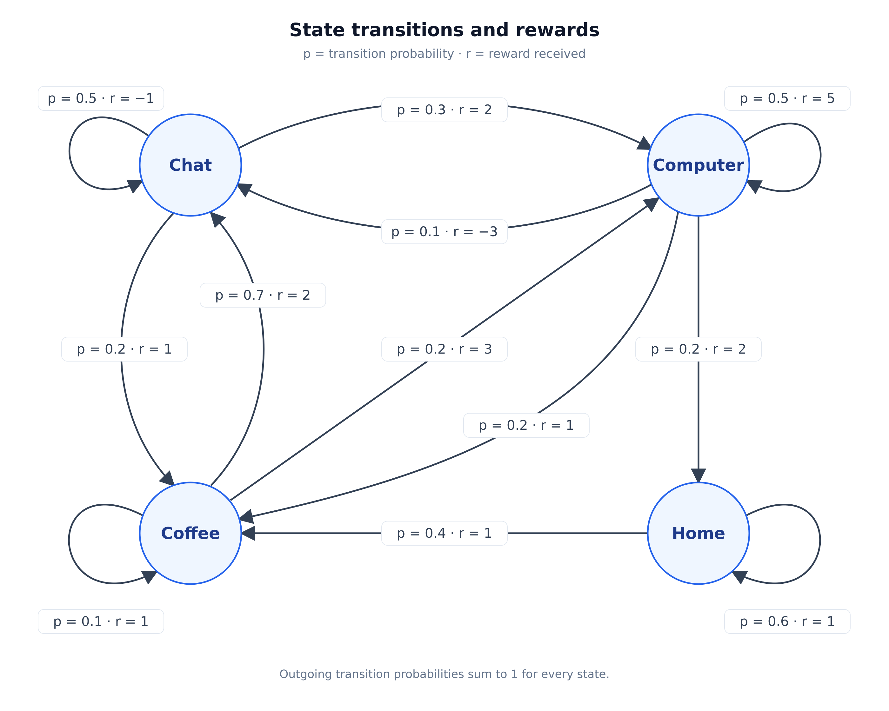

# This file will include the material that I have learned or currently learning.

[[_TOC_]]

## Markov Process (MP):

Before I move onto Markov decision processes, MDP, I'll start with the simplest case of the Markov family, the Markov process. Later, I will extend this with rewards which will turn it into a markov reward process, MRP, then I will add actions which will lead to the MDP.

**The Markov Process also called the Markov Chain:**

This is the simplest stochasitc model of a process that changes overtime. The key constraints are:

- You cannot contrl it (no action)
- You can only observe it
- The future depends only on the present, not the past (Markov property)

Imagine we have a system infront of us that we can only observe. What we observe is called states, and the system switches between states. We cannot influence the system, only watch the state change. All possible states for a system form the systems state space, and for an MP we require this set to be finite. Our observations form a sequence of states or a chain, hence why it is sometimes called a markov chain.

### Concrete Example

Lets say we are watching the weather. We can observe the current day as rainy or sunny, which makes up our state space. A sequence of observations overtime form a chain of states, such as ["rainy", "sunny", "sunny", "rainy", "sunny", ..., "rainy"]. This is called history. To call this system an MP it needs to fulful the markov property. $P(s_{t+1} | s_{t}, s_{t-1},...,s_{0}) = P(s_{t+1} | s_{t})$. So the probability of state $s_{t+1}$ only depends on state $s_{t}$. To use our example, the probability of whether or not tomorrow is sunny, $s_{t+1}$, only depends on todays weather, $s_{t}$.

This means every state is self-contained, meaining a state must contain all the information needed to predict the next state. Since this hols for all states, it allows us to predict all future states. i.e., $s_{t} \rightarrow s_{t+1} \rightarrow s_{t+2} \rightarrow \cdots$

So, the markov property states that the current state $s_{t}$ contains all the information needed to predict the distribution (not a single deterministic outcome) over the next state $s_{t+1}$. Here The distribution are all the values $s_{t+1}$ could take and the probability of each one.

### Transition Matrix:

We can capture transition probabilities with a transition matrix, which is an N x N matrix, Where N is the number of states in our system. Each row represents a conditional probability distribution over the next state, given the current state, so its entries sum to 1. For discrete states, we can visualise a row as a bar chart, with possible next states on the x-axis and their probabilities on the y-axis.

In practice, we rarely know the transition matrix, instead what we observe is a sequence of states overtime. These sequences are called trajectories.

## Markov Reward Processes (MRP)

Markov processes only had states and transition probabilities. It could tell you "from state A you go to state B with probability 0.3", but it could not tell you if that was good or bad. To take this into account, we add rewards.

The most general way to represent rewards is a reward matrix $R$, similar to a transition matrix $T(i, j)$, we have a square matrix $R(i,j)$ witch gives a reward from transitioning from state i to state j. A reward can be positive, negative, large, or small. It is just a scalar value that tells the agent gow desirable that transition was. If the reward only depends on the state you reach, not what state you come from, then instead of $R(i, j)$ we can just use $R(x)$ i.e., just assign a reward to each state.

The second thing we're going to add is a discount factor $\gamma$ which is a single value between 0 and 1 (inclusive). It controls how much we care about future rewards. If $\gamma \approx 0$ then we care almost only about immediate reward, if $\gamma \approx 1$ then we care a lot about future rewards.

So now every transition has a reward. In MP we had $s_{0} \rightarrow s_{1} \rightarrow s_{2} \cdots$ now in an MRP we have $s_{0} \xrightarrow{r_{1}} s_{1} \xrightarrow{r_{2}} s_{2} \xrightarrow{r_{3}} \cdots$. The reason the reward index is one ahead is because it is given after we have transitioned. So $r_{1}$ is the reward for transitioning from $s_{0}$ to $s_{1}$.

### Return

We can define $G_{t}$ to be the return from time step $t$ along a particular episode, only counting rewards that come after that point. If the episode ends at time $T$:

$$
G_{t} = R_{t+1} + \gamma R_{t+2} + \gamma^{2}R_{t+3} + \cdots + \gamma^{T - t - 1}R_{T}
$$

$\gamma$ represents the shortsightedness of the agent. if $\gamma = 1$ then return is just the sum of all subsequent rewards. If $\gamma = 0$ then the return will just be the immediate reward $r_{t+1}$. In practice this value is usually between $0.9 \leq \gamma \leq 0.99$.

### Value Function

However, $G_{t}$ is not very useful in pracice since different episodes can produce different returns from the same state $s_{t}$. i.e., if we start in $s_{t}$ one episode might give a big reward (we just happen to go to states that give a higher reward), one episode mat give a small reward (we just happen to go to states that give a lower reward). $\therefore G_{t}$ is high variance, random, and depends on chance. Instead, we use the value function:

$$
V(s) = E[G_{t} | s_{t} = s]
$$

This moves from "What return did we get on a particular run" ($G_{t}$), to "what return should we expect, on average, from this state" ($V(s)$). We can think of this as a probability distribution where $G_{t}$ is on the x-axis and $p(G_{t} | s_{t} = s)$ is on the y-axis. The mean of this distribution is $V(s)$.

The true value of state $s$ is the expected return from that state:

$$
V(s) = \mathbb{E}[G_{t} \mid S_{t} = s]
$$

We estimate it by averaging $N$ sampled returns from $s$, where $G_{t}^{(i)}$ is the return from the $i$th run. Under the law of large numbers, this estimate converges to the true value as $N$ increases:

$$
\hat{V}_{N}(s) = \frac{1}{N}\sum_{i=1}^{N}G_{t}^{(i)}
\xrightarrow{N \to \infty} V(s)
$$

### Concrete Example

  

Lets start with the case where we only care about the immediate reward, $\gamma = 0$. So we want to know the value of the states when $\gamma = 0, G_{t} = r_{t+1}$. So $V(s) = E[r_{t+1} | s_{t} = s]$. To find the mean of a discrete distribution we can use $\sum^{n}_{i=1}(\text{probability} \times \text{reward})$.

$V(\text{chat}) = 0.5(-1) + 0.2(1) + 0.3(2) = 0.3$

$V(\text{computer}) = 0.5(5) + 0.2(2) + 0.2(1) + 0.1(-3) = 2.8$

$V(\text{coffee}) = 0.7(2) + 0.2(3) + 0.1(1) = 2.1$

$V(\text{home}) = 0.6(1) + 0.4(1) = 1.0$

If we only care about immediate rewards ($\gamma=0$), Computer is the most valuable state to be in because it has the highest expected immediate reward. In this example, setting ($\gamma=1$) would make the expected return infinite from every starting state: the process continues indefinitely, and every state has an expected immediate reward of at least 0.3, so the expected accumulated reward grows without bound. Choosing ($0 \lt \gamma \lt 1$) gives progressively less weight to rewards further into the future and, because the rewards are bounded, keeps the infinite discounted return finite.

The probability of a given $G_{t}$ is the product of the transition probabilities across that path. For example, using the diagram, the return of the path Chat $\rightarrow$ Computer $\rightarrow$ Home is $G_{t} = 2 + \gamma (2)$, its probability is $0.3 \times 0.2 = 0.06$. We can think of this as one bar chart on our distribution for V(s). An important distinction to make is that different paths can have the same return. To find the probability of a particular return value, we add all the probabilities of all paths producing it.

## Markov Decision Process (MDP)

To extend MRP to MDP we add a set of actions $A$, which has to be finite. This makes our agents action space. For an MDP, the agent no longer passively observes state transitions, but can suggest an action to take at every state transition. This now means the agent can influence outcomes, which is a useful ability.

### Policy

The simple definition of a policy is that it is just a rule, or set of rules, that tell our agent what actions to take, usually written as $\pi(a | s)$. The main objective in reinforcement learning is to maximise the expected return. Formally, polity is defined as the probability distribution over actions for every possible state:

$$
\pi(a | s) = p[A_{t} = a | S_{t} = s]
$$

So for a given state, s, the policy gives a distribution over the actions we can take from that state, where actions are on the x-axis, and probability (denisty if a is continuous) is on the y-axis.

### Value functions and Bellman expectation equations

#### State Value Function

$V^{\pi}(s)$ is the probability-weighted average of all possible returns $G_{t}$ when starting in state $s$ and following policy $\pi$. This includes all possible first actions selected by the policy and all possible outcomes afterwards.

$$
V^{\pi} = E_{\pi}[G_{t} | S_{t} = s]
$$

#### Action Value Function

$Q^{\pi}(s,a)$ is the probability-weighted average of all possible returns $G_{t}$ when starting in state $s$, taking action $a$, and following policy $\pi$ afterwards. The first action is fixed, but we still average over all possible outcomes and subsequent actions.

$$
Q^{\pi}(s,a) = E_{\pi}[G_{t} | S_{t} = s, A_{t} = a]
$$

The distinction is that $V^{\pi}(s)$ averages the possible returns $G_{t}$ across all possible first actions under policy $\pi$, whereas $Q^{\pi}(s,a)$ averages the possible returns $G_{t}$ when the first action is fixed to $a$. Both averages account for all possible outcomes and subsequent actions, weighted by their probabilities.

#### Connecting state values and action values

Starting in state $s$, we can group the possible returns $G_{t}$ according to the first action taken. For each action $a$, the probability-weighted average of the returns in that group is $Q^{\pi}(s,a)$.

To obtain $V^{\pi}(s)$, we average these Q-values, weighting each one by the probability $\pi (a | s)$ of choosing that first action:

$$
V^{\pi} (s) = \sum_{a} \pi(a | s) Q^{\pi}(s,a)
$$

This is the law of total expectation: averaging the possible returns within each first-action group, then weighting those group means by the probabilities of choosing the actions, gives the same result as averaging all possible returns from $s$ directly.

#### Expressing action values using the next state

$Q^{\pi} (s,a)$ is the probability-weighted average of all possible returns $G_{t}$ when starting in state $s$, taking action $a$, and following policy $\pi$ afterwards:

$$
Q^{\pi} (s, a) = E_{\pi} [G_{t} | S_{t} = s, A_{t} = a]
$$

Each return consists of the immediate reward plus the discounted remaining return:

$$
G_{t} = R_{t+1} + \gamma G_{t+1}
$$

Substituting this gives:

$$
Q^{\pi} (s, a) = E_{\pi} [R_{t+1} + \gamma G_{t+1} | S_{t} = s, A_{t} = a]
$$

We can now group the possible returns according to the next state $s'$ reached and the immediate reward $r$ received. Within each group, the immediate reward is fixed. Under the Markov property, the probability-weighted average of the remaining returns $G_{t+1}$ is $V^{\pi} (s')$, since we follow policy $\pi$ from that next state onwards.

The mean return within each group is therefore:

$$
r + \gamma V^{\pi}(s')
$$

Using the law of total expectation, we average these group means according to the probabilities of reaching their next states and receiving their rewards:

$$
Q^{\pi} (s, a) = \sum_{s', r} p(s', r | s, a) [r + \gamma V^{\pi}(s')]
$$

Equivalently, we can keep this in expectation notation:

$$
Q^{\pi} (s,a) = E_{\pi} [R_{t+1} + \gamma V^{\pi}(S_{t+1}) | S_{t} = s, A_{t} = a]
$$

Both expressions give the same probability-weighted average as the original definition using $G_{t}$. We have grouped the possible returns and averaged within each group, allowing us to express the action value using the immediate reward and the values of the possible next states.

#### The Bellman expectation equation for state values

We have seen that $V^{\pi}(s)$ is the probability-weighted average of the Q-values for the available actions in state $s$:

$$
V^{\pi}(s) = \sum_{a}\pi(a\mid s)Q^{\pi}(s,a).
$$

We can now substitute our expression for each Q-value:

$$
V^{\pi}(s) =
\sum_{a}\pi(a | s)
\sum_{s',r}p(s',r | s,a)
[r+\gamma V^{\pi}(s')].
$$

This is the Bellman expectation equation for state values. It calculates the average in two stages:

1. For each possible first action $a$, average $r+\gamma V^{\pi}(s')$ over the possible next states and rewards, weighted by $p(s',r\mid s,a)$. This gives $Q^{\pi}(s,a)$.
2. Average these Q-values, weighting each one by the probability $\pi(a | s)$ of choosing that first action. This gives $V^{\pi}(s)$.

Equivalently, we can write:

$$
V^{\pi}(s)= E_{\pi}[R_{t+1}+\gamma V^{\pi}(S_{t+1}) | S_{t}=s].
$$

The expectation includes all possible first actions under policy $\pi$ and their possible next states and rewards. It gives the same probability-weighted average of returns $G_{t}$ as our original definition of $V^{\pi}(s)$, now expressed using immediate rewards and next-state values.

#### Worked example

Suppose we are in state $s_{1}$, where three actions are available: $a_{1}$, $a_{2}$, and $a_{3}$. Our policy selects these actions with 
probabilities $0.7$, $0.1$, and $0.2$, respectively. If we take action $a_{1}$, we reach $s_{2}$ with probability $0.3$,
$s_{3}$ with probability $0.3$, or $s_{4}$ with probability $0.4$. In this example, the reward is fixed for each transition: 
these three outcomes give immediate rewards of $1$, $2$, and $1$, respectively. The possible next states, transition probabilities,
and rewards for the other two actions are shown in the diagram. We will first calculate the probability-weighted average of the immediate
reward plus the discounted next-state value for each action, giving its Q-value. We will then average these Q-values using the policy 
probabilities to obtain $V^{\pi}(s_{1})$.

For each action, we can visualise a probability distribution over the immediate reward plus the discounted value of the next state, $R_{t+1}+\gamma V^{\pi}(S_{t+1})$.
The Q-value is the mean of this distribution: we multiply each possible value $r+\gamma V^{\pi}(s')$ by the joint probability $p(s', r | s,a)$ of receiving that reward and
reaching that next state, then sum the results. In this example, the reward is fixed for each transition, so each bar's height is simply the probability of reaching its next 
state, given the current state and chosen action. The three graphs show these distributions for actions $a_{1}$, $a_{2}$, and $a_{3}$, with their probability-weighted 
means giving the corresponding Q-values.

Using the law of total expectation, we can obtain $V^{\pi}(s_{1})$ by taking a probability-weighted average of the three Q-values. Each Q-value is the mean of the possible 
returns grouped by a particular first action, and the probability of selecting that group is the policy probability $\pi(a_{i}\mid s_{1})$. We therefore multiply each Q-value 
by its action probability and sum the results: $V^{\pi}(s_{1}) = 0.7Q^{\pi}(s_{1},a_{1}) + 0.1Q^{\pi}(s_{1},a_{2}) + 0.2Q^{\pi}(s_{1},a_{3})$. This weighted mean of the 
group means equals the probability-weighted average of all possible returns from $s_{1}$ under policy $\pi$.